# AI 像素角色測試 01

> 2026-11-23 定案：**MiniMax H3 單一主線**（見 REVIEW-01、SETUP 第 3 節）。本輪曾短暫下載並試跑路線 A（Qwen Edit / FLUX.2 klein / Wan 2.2），結果僅留在「附錄：路線 A 試跑」供參考，不再繼續。

## 環境

- OS：Windows 11 Pro（10.0.26300）、RAM 64GB
- GPU：RTX 5060 Ti 16GB，驅動 616.92
- ComfyUI：**Comfy Desktop**（非 SETUP 建議的 Portable），ComfyUI 0.46.2、前端 1.59.6，port **8000**
  - 啟動參數：`--use-sage-attention --disable-pinned-memory --enable-manager`
  - 機器上已有可用的 Desktop 安裝，版本符合 H3 Image（≥ 0.45）需求，不重裝。腳本預設連 `http://127.0.0.1:8000`。
- PyTorch 2.13.0+cu130、Python 3.13（ComfyUI 內）；工具腳本用 Python 3.12 `.venv-art`
- 模型資料夾：`%LOCALAPPDATA%\Comfy-Desktop\ComfyUI-Shared\models`（與使用者其他 ComfyUI 專案共用）

### H3 模型

| 用途 | 檔案 | 備註 |
| --- | --- | --- |
| H3 Image DiT | `minimax_h3_image_pruned_int8_convrot.safetensors` | SETUP 建議 w4a8；機器上已有 int8，照官方範本使用 |
| H3 Image 文字編碼器 | `qwen3vl_32b_minimax_h3_int8_convrot.safetensors` | 官方範本預設 |
| H3 Image VAE | `minimax_h3_image_vae_fp16.safetensors` | |
| H3 影片 DiT | `minimax_h3_fl2va_pruned_int8_convrot.safetensors` | 19.5GB |
| H3 影片 turbo LoRA | `minimax_h3_fl2v_turbo_8step_v1.0_comfyui_bf16.safetensors` | lightx2v，8 步 |
| H3 影片文字編碼器 | `qwen3vl_32b_minimax_h3_nvfp4_awq.safetensors` | FP4 |
| H3 影片 VAE | `minimax_h3_video_vae_int8_convrot.safetensors` | |

### H3 配套（REVIEW-01 第 6 點）— **未完成，見「問題」**

| 項目 | 狀態 |
| --- | --- |
| `JOYUNGI/pixelart8x-h3-lora`（v3） | **找不到**：Hugging Face（`JOYUNGI` 作者、`pixelart8x` 關鍵字）與 Civitai 都查無此模型。HF 上有的 H3 像素類 LoRA：`KennethFal/16bit-pixel-lora-minimax-h3`、`Leon1000/16bit-pixel-lora-minimax-h3`、`ij/PixelTune-MiniMax-H3-LoRA`、`pocis/MiniMax-H3-Video-PixelHead`（未驗證） |
| bunnyUFO `sprite-from-prompt-h3` 工作流 | 已下載檢視：用的就是我們的 H3 影片 DiT（他們用 w6a8）＋ nvfp4 編碼器＋8 步 turbo LoRA，768²／39 幀，**峰值 VRAM 約 21.7GB**（16GB 要降解析度）。「x8-v3」指的是其清理節點的參數版本，不是 LoRA。需要該 repo 的自訂節點 `comfyui_workflows_utils`（PrepareSpriteForVideo、CleanVideoFrames、PickEvenFrames、SaveSpriteSheet…） |
| PixelForge-H3（`japaneserunic/blubs-pixel-nodepack`，MIT） | 未安裝 |

兩套自訂節點都要把第三方程式碼裝進 ComfyUI，本機的 Claude Code 權限設定擋下了這一步，等使用者確認後再裝。

## 試跑紀錄（H3）

| 模型 | 解析度/幀數 | 耗時 | VRAM 峰值 | 備註 |
| --- | --- | --- | --- | --- |
| H3 Image edit（冷） | 1024² | 40.4 s | 15.1 GB | 含載入；6 步 euler cfg 1 |
| H3 Image edit（熱，1 張參考圖） | 1024² | 9.1 s | 15.1 GB | |
| H3 Image edit（熱，2 張參考圖） | 1024² | 15–30 s | 15.1 GB | 角色＋人台 |
| H3 Image edit（熱） | 512² | 19.2 s | 15.5 GB | 較糊，不用 |
| H3 影片 I2V（冷） | 512² / 56 幀 | 40.8 s | 15.5 GB | 首尾同幀；8 步 turbo、res_multistep |
| H3 影片 I2V（熱） | 512² / 56 幀 | 29–30 s | 15.4 GB | |

VRAM 峰值為 `nvidia-smi` 整卡用量（含桌面）。全程沒有 OOM。

## M 人台與姿勢模板

- **3.5 頭身**：從 H3 生成的側面人台切頸部，頭／身分別縮放到 16 px／40 px（身體橫向 ×1.15 加厚），依畫布規格貼到 1024² 畫布（腳底 y=976、中線 x=512）後讓 H3 重畫。4 個 seed 實測全部 **56 px 高、頭 16 px、3.5 頭身**。
- **H3 會沿用參考圖位置**：參考圖照規格擺好，輸出的頂端 y=96、腳底 y=991，縮放比剛好 0.5，不用再估比例。
- 有手臂（`stand`）與無手臂（`stand_noarm`）兩版。
- 姿勢模板 20 個（`art/ai/mannequins/M/`，定義在 `poses.yaml`）：walk_contact_a/b、run_a、aim_1–2、shoot_1–3、melee_1–6（球棒）、hit_1–3、death_1/4/8。每個 2 seed 挑一張。腳底全部 y=61；站姿頭頂都在 y=6（melee_1/5 高出的是球棒、shoot_1 是後仰、death 低於是正常）。
- 疊圖：`templates_contact.png`、`overlay_check.png`。
- 失敗：`walk_pass_a`（過渡姿勢）兩個 seed 都畫成大步，沒有收腿；之後改提示詞重做。灰色人台的近腳／遠腳不易區分，contact_a / contact_b 看起來差不多。

## 第九輪（STYLE_ANCHOR 續）：一般霧屍上 M 人台（站姿＋走路 8 格）、危險紅、阿凱雙手

> 接第八輪（STYLE_ANCHOR 續）審圖（五個人台定案）。和其他系列的輪次編號無關。

### 1. 主調色盤：危險紅 3 階＋布料灰 3 階

`master.gpl` 主色從 48 色擴為 54 色，原本 0–47 的顏色和索引都不變：

| 索引 | 名稱 | 色值 | 用途 |
| --- | --- | --- | --- |
| 48–50 | 危險紅 | `#6e1c1c`／`#a8302a`／`#d84a3a` | 飽和度上限放寬到 0.75，**只給可互動／危險物件**（`build_anchor.py` 的 `DANGER_SLOTS`，目前只有油桶） |
| 51–53 | 布料灰（**計畫外新增**） | `#979b96`／`#b3b7b2`／`#cdd1cc` | 中性灰，霧屍上衣用 |
| 54–63 | 保留色 | 同前 | 10 色 |

**為什麼要加布料灰**：
- ZombieComposer 判斷「上衣」的條件是 s<0.07 且 v>0.58。
- 原本的 48 色在第六輪建調色盤時，把淺灰往灰綠偏，彩度變成 0.08–0.11，**符合上衣條件的只剩 1 色**（`#d7e5d8`）。這樣霧屍上衣沒辦法分明暗，而且只要任何一格偏一點，就會被分到皮膚區。
- 加了 3 個中性灰之後，上衣可用 4 色。
- 這不在審圖指示裡，請確認。

### 2. 油桶：危險紅＋大片鏽斑＋圓柱明暗

**重跑**（`drum9`，4 個 seed，`drum9_seeds_x4.png`）：
- 提示詞加上「左側一條亮的直欄、右側一條暗的直欄、頂緣一條高光」。
- 量化時用主色 51 色（48＋危險紅），色相權重 ×2。
- 新增後處理 `shade_cylinder`：每列左側第一個內部像素調亮一階、右側最後一個調暗一階，頂緣第一個內部列調亮一階。只用這個物件本來就有的顏色，所以色數不變。

**結果**：
- seed 2 高 45、seed 4 高 41，淘汰；seed 1 高 33，超出 28–31。
- **選 seed 3**：21×30。
- 用色：
  - 桶身：`#d84a3a`（亮危險紅）
  - 右側暗欄：`#6e1c1c`（暗危險紅）
  - 左側亮欄和頂緣高光：`#d79972`
- 中間的 `#a8302a` 在 10 色限制下被併掉了。`shade_cylinder` 在這張只改了 14 px，大部分欄位 H3 已經畫對。

### 3. 阿凱：雙手自然下垂

- **新的版面參考**（`layout_akai9_8x.png`）：阿凱位置放 3/4 側面 M 人台（`stand34`，雙手下垂），頭換成阿凱 3.5 頭身拼貼的頭，讓 H3 照這個姿勢畫。
- **提示詞**：照第八輪（棕髮、條紋），加上「both arms hanging naturally straight down at his sides, bare forearms and hands clearly visible below the short sleeves」。
- **結果**（`akai9_seeds_x4.png`）：4 張的手都垂在身側，前臂和手都看得到。
- **選 seed 2**：25×56，16 色＋識別色 2，棕髮和紅 7 清楚。
- **注意**：條紋比第八輪少，只剩 2–3 條。H3 這次畫的條紋比較細，縮小 ÷8 時有一部分被濾掉了。

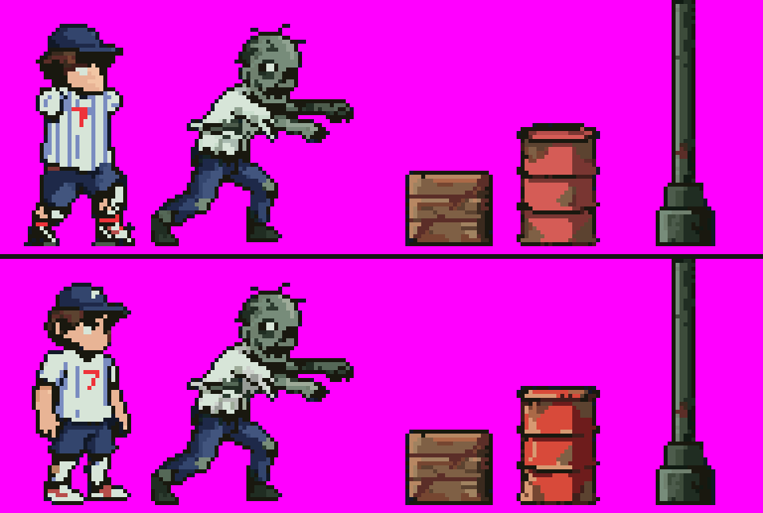

| 物件 | 尺寸 | 色數 |
| --- | --- | --- |
| 阿凱（akai9 s2） | 25×56 | 16＋識別色 2 |
| 霧屍（s2） | 51×56 | 16 |
| 木箱（s2） | 22×19 | 10 |
| 油桶（drum9 s3） | 21×30 | 10 |
| 路燈（s2） | 15×62 | 10 |

整張共 37 色，0 色超出調色盤。

### 4. XL 畫格、刪除第七輪人台

- `ART_STYLE_SPEC.md` 的畫格規格加上「**XL（胖／壯）所有動作一律 64×72、腳底 y=69**」，調色盤一行改成 54 主色（含危險紅、布料灰）。
- 已刪除第七輪的純側面人台：`S/M/L/side_stand_*.png`、整個 `XL/` 資料夾。第七輪的 `r7_*` 對照表保留，供報告對照。

### 5. 一般霧屍 M 版（站姿＋走路 8 格）

輸出：`art/ai/out/zombie_m/`。工具是 `tools/art/ai/build_zombie9.py`（refs → stand-gen/post/pick → walk-gen/post/pick）。

| 檔案 | 內容 |
| --- | --- |
| `stand.png` | 站姿 64×64 |
| `walk.png` | 走路 8 格 × 64×64；另有 `walk.json`（8 fps 循環）、`walk.gif` |
| `stand_seeds_x4.png` | 站姿 4 個 seed 對照表（三排：÷16 原圖、後處理結果、分區色塊圖） |
| `walk_seeds_x3.png` | 走路 4 個 seed 對照表 |
| `contact_walk.png` | 選定走路的 4 倍對照表 |
| `stand_regions_x4.png`、`walk_regions_x4.png` | 分區色塊圖（白＝上衣、藍＝褲子、綠＝皮膚、黑＝外框、灰＝其他） |
| `meta.json` | 記錄參數 |

**站姿**（H3 Image 1024²，3 張參考圖）：
- Picture 1：M 人台 `stand34`
- Picture 2：現行霧屍第 0 格
- Picture 3：anchor
- 提示詞：灰綠皮膚、破爛中性淺灰上衣、藍灰褲子，頭上什麼都不戴；保留人台的位置、身高、頭和 3/4 側面；微駝、雙手無力前垂。
- 4 張都畫成 M 人台比例（57–58 高、頭 16–17、寬 27–28）。
- **選 seed 3**：57 高、頭 16、寬 28，16 色。其他 seed 的上衣裡混著皮膚或褲子分區的雜點。

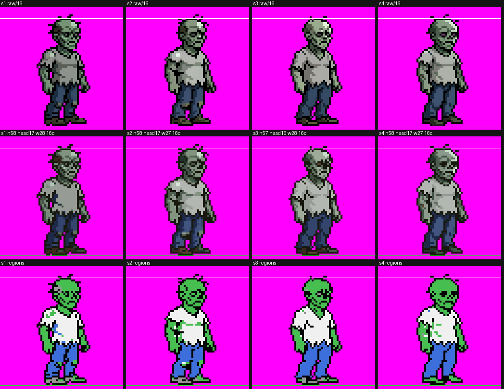

**走路**（H3 影片 512²，56 幀）：
- 首尾幀都用定案站姿放大 8 倍。
- 提示詞：原地拖步走、駝背、手臂前垂擺動、兩腳交替。
- 每個 seed 用 `pick_frames.py loop` 自動找出循環，取 8 格。
- **選 seed 3**：週期 34 幀，兩腳交替的跨步最明顯，8 格高 55–57、腳底全在 y=61、16 色。
  - seed 1 跨步小。
  - seed 2 週期 47 幀，取出來的 8 格動作稀疏。
  - seed 4 的頭有一格晃得太大。

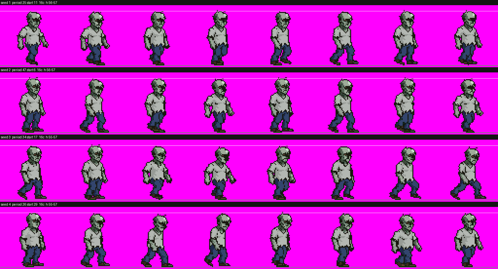
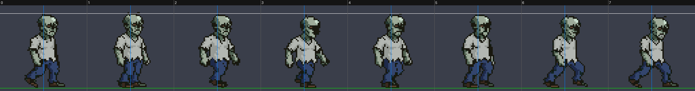
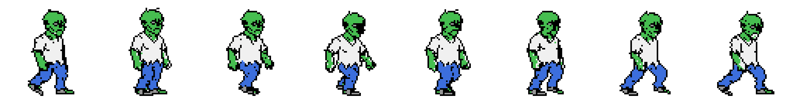

**分區後處理**（規則照 ZOMBIE_REACT §2，和 `classify()`／ZombieComposer 相同）：
1. 先用原圖顏色判斷每個像素屬於哪一區（門檻放寬一點，因為 H3 的顏色不會剛好落在界線內）。
2. 每個像素只能量化到 master.gpl 裡**同一區**的顏色，所以分區不會互相滲透。
3. 邊緣像素一律用近黑外框色（`#19180f`、`#101b13`，v<0.11）。
4. 8 格合在一起減到 ≤16 色，合併只在同一區內進行，所以不會逐格閃爍。

途中修了兩個分區問題：
- **上衣陰影**：明度 0.3–0.5 的中性灰原本被分到「其他」，對到紫灰 `#766f8e`，上衣看起來偏紫，遊戲換色時陰影也不會跟著變。改成中性灰 v>0.32 都算上衣，用最暗的布料灰當陰影。
- **頭頂高光**：頭頂的淺灰高光被分成上衣，換上衣色時頭上會出現色點。改成身體上方 28%（頭部）不可能是上衣，一律算皮膚。

**驗收**：

| 項目 | 站姿 | 走路（8 格合計） |
| --- | --- | --- |
| 高度 | 57 | 55–57 |
| 外框 | 342 px | 2735 px |
| 上衣 | 238 | 1890 |
| 褲子 | 185 | 1201 |
| 皮膚 | 211 | 1393 |
| 其他（鞋、眼窩） | 20 | 141 |
| 超出調色盤 | 0 | 0 |

- 三個分區都完整：上衣、褲子各是一整塊，頭部全是皮膚。
- 鞋子是「其他」，遊戲換色時不會變。這和現行霧屍一樣（現行版也有 269 px 的「其他」）。

**需要雲端注意**：
- **腳底線**：這裡照 ART_STYLE_SPEC 用 y=61，但遊戲端的 `ZombieComposer.FOOT_ROW = 62`（現行霧屍）。接進遊戲時，請把 FOOT_ROW 改成 61，或在合成時整張往下移 1 列。
- **格數**：現行霧屍走路是 4 格（`zombie_walk` 用 0–3），這次給了 8 格。動畫設定要改成 8 格，或隔格取 4 格。
- **3.5 頭身**：新版是 3.5 頭身，頭比現行霧屍小。`HEAD_ANCHORS`（頭飾錨點）需要依新圖重新量。

### 驗收

- [x] 主色加危險紅 3 階（飽和度 ≤0.75，只給油桶）
- [x] 油桶紅漆＋大片鏽斑＋左亮右暗＋頂緣高光，21×30
- [x] 阿凱雙手垂在身側，前臂和手可見，56 高
- [x] XL 動作畫格 64×72（腳底 y=69）寫進規格
- [x] 第七輪純側面人台已刪除
- [x] 一般霧屍 M 版站姿＋走路 8 格，各 4 個 seed，3/4 側面，分區色正確，16 色
- [ ] 布料灰 3 階是計畫外新增，請確認
- [ ] 接進遊戲時處理腳底線（61 vs 62）、走路格數、頭飾錨點（雲端）

## 第八輪（STYLE_ANCHOR 續）：3/4 側面人台、XL 胖／壯、阿凱與油桶重跑

> 接第七輪（STYLE_ANCHOR 續）審圖（S／M／L 通過），和下面的「第八輪（MELEE_WEAPONS）」是不同兩輪。

### 1. 色數規則與阿凱重跑

**規則**：物件 ≤10 色；角色（阿凱、霧屍、人台）≤16 色，主角識別色另計、不佔名額。
- `limit_colours` 新增 `uncounted` 參數，識別色不算進上限。
- 樣板圖依物件類型套用上限，見 `build_anchor.py` 的 `CHARACTERS`。

**阿凱重跑**（`akai8`，4 個 seed，只取阿凱那一段合成）：
- 提示詞加上：
  - 頭髮要「clearly brown, not black」
  - 球衣條紋要「clearly visible thin vertical blue pinstripes evenly spaced across the whole jersey」
- 4 張都恢復了棕髮和條紋（`akai8_seeds_x4.png`：上排是縮小 ÷8 的原圖，下排是後處理結果）。
- **選 seed 2**：28×56，條紋最均勻。seed 3 高 58，超出 ±1。
- 色數：16 色＋識別色 2 色，共 18 色。

### 2. 油桶：紅漆桶身＋大片鏽斑

**改法**（`drum8`，4 個 seed，`drum8_seeds_x4.png`）：
- 提示詞改成「bright crimson red paint (the same red as the boy's number 7) covers most of the drum, a few large flat brown rust patches … must not look like a brown drum」。
- 油桶量化時色相權重 ×2（`quantize(..., hue_weight=2)`）：紅漆會落在主色的紅色系（`793632`／`b74e4b`／`d55c56`），不會被拉到明度相近的咖啡色。

**結果**：4 張都是紅色桶身。
- seed 1 高 33、seed 2 高 45，超出 28–31，淘汰。
- **選 seed 3**：21×31，大片斜向鏽斑，三道桶箍清楚。

**注意**：
- 主色裡最紅的是 `b74e4b`／`d55c56`（第六輪聚類出來的），所以油桶看起來偏鮭魚紅，不是鮮紅。如果要更鮮的紅，需要在主色加一個高彩度的紅（或把油桶紅列進保留色）。
- 油桶的左上受光量測接近 0（+0.00）：紅漆和鏽斑的明暗分布比較平均，看圖亮面不明顯。

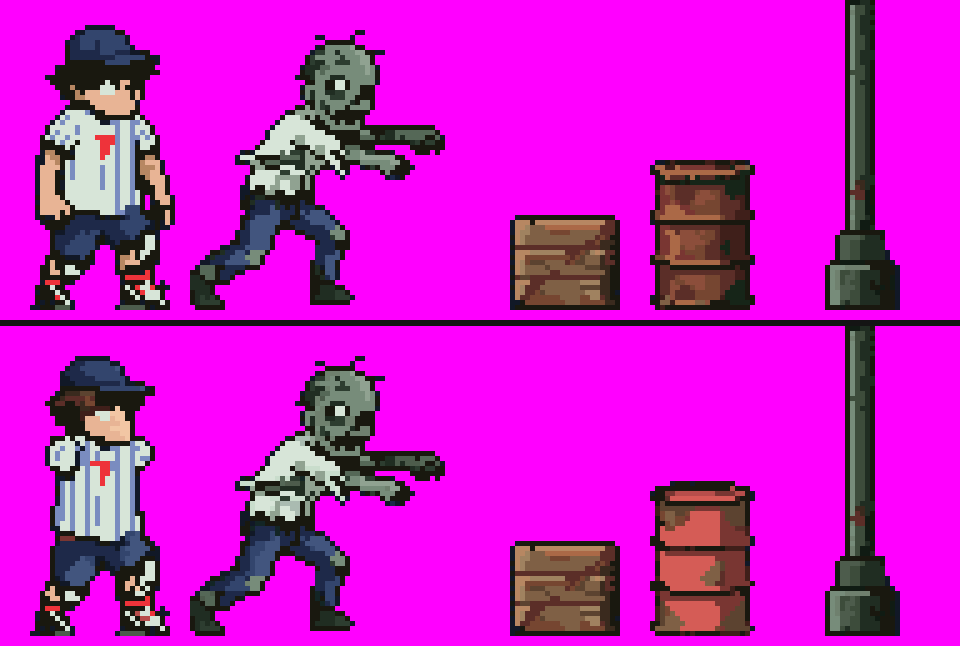

| 物件 | 尺寸 | 色數 | 上限 |
| --- | --- | --- | --- |
| 阿凱（akai8 s2） | 28×56 | 16＋識別色 2 | 16＋識別色 |
| 霧屍（s2） | 51×56 | 16 | 16 |
| 木箱（s2） | 22×19 | 10 | 10 |
| 油桶（drum8 s3） | 21×31 | 10 | 10 |
| 路燈（s2） | 15×62 | 10 | 10 |

整張共 34 色，0 色超出 master.gpl。腳底都在 y=61。

### 3. 人台改 3/4 側面、XL 拆胖／壯

輸出：`art/ai/mannequins/{S,M,L,XL_fat,XL_strong}/stand34_64.png`（另附 `_512`），參數記錄在 `r8_meta.json`。第七輪的純側面版 `side_stand_*.png` 和 `XL/` 保留不刪，供參考。

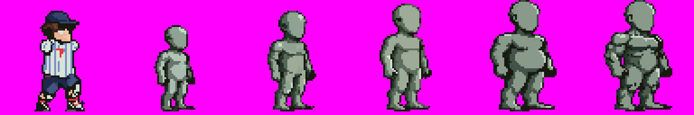

做法：
- **Picture 1**：來源改成第二輪的 3/4 側面 M 人台 `M/stand_512.png`（寬 28）。在頸部（y=22）切開，用 `make_mannequin_ref.py` 縮放頭和身體。XL-胖和 XL-壯共用同一張 1.4 倍寬的參考圖，體型差異交給提示詞。
- **Picture 2**：`anchor.png` 放大 5 倍。
- **提示詞**：「three-quarter view like the boy in Picture 2: body faces right, torso turned slightly toward the camera, chest and both shoulders visible」。
  - XL-壯另外描述：寬肩厚胸、腰明顯比肩窄、平腹無肚子、手腿粗。
- **色數**：角色 ≤16 色，只用 48 主色。
- **頭高量法修正**：改成取「頸部窄段的最後一列」。舊量法用在 3/4 參考圖上會量到 13，新量法量 4 張參考圖都正好是 14／16／17／18。

| 體型 | 規格（高／頭） | 選定 | 實測高 | 實測頭 | 寬 | 寬／M | 色數 | 受光差 |
| --- | --- | --- | --- | --- | --- | --- | --- | --- |
| S | 48／14 | seed 2 | 48 | 14 | 23 | 0.85 | 16 | +0.07 |
| M | 56／16，寬 24–28 | seed 2 | 56 | 16 | **27** | 1.00 | 16 | +0.04 |
| L | 60／17 | seed 3 | 60 | 17 | 29 | 1.07 | 16 | +0.07 |
| XL-胖 | 62／18，寬 1.4× | seed 2 | 62 | 18 | 37 | 1.37 | 16 | +0.05 |
| XL-壯 | 62／18，肩寬 1.4× | seed 3 | 62 | 17 | 38 | 1.41 | 16 | +0.06 |

每個體型 4 個 seed 的對照表（上排 ÷16 原圖，下排後處理結果；綠線腳底、白線規格頭頂、黃線規格頭底）：

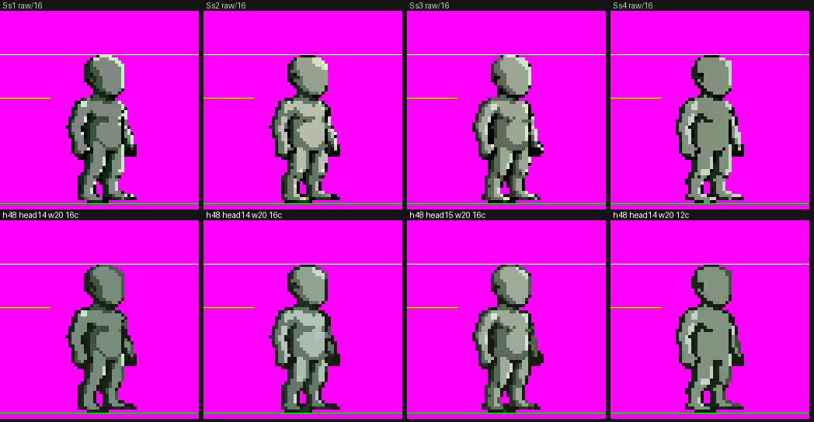
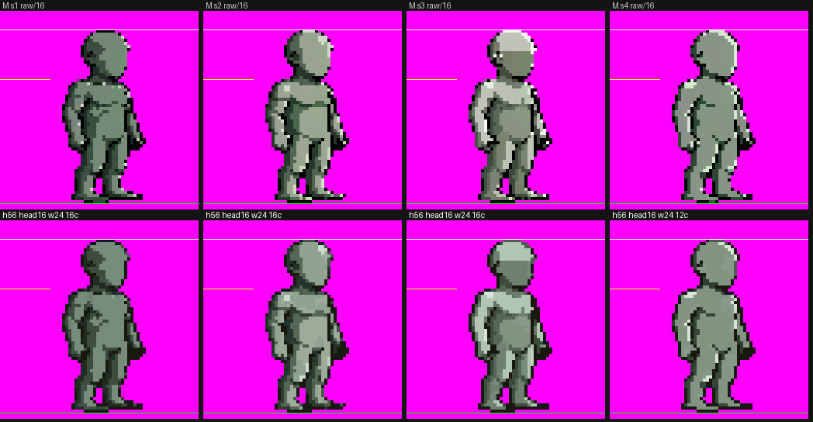
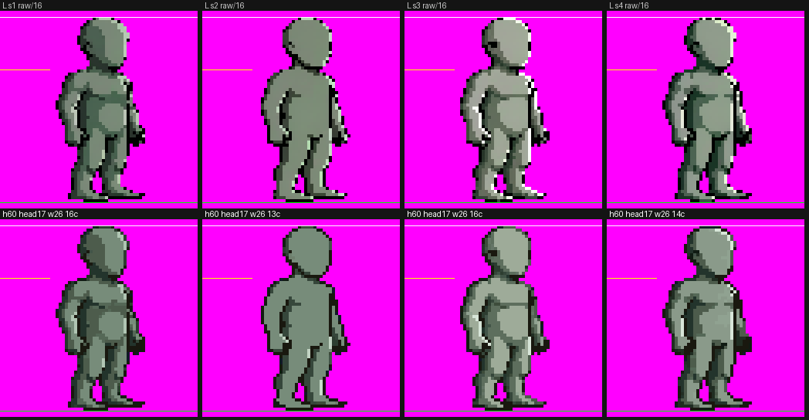
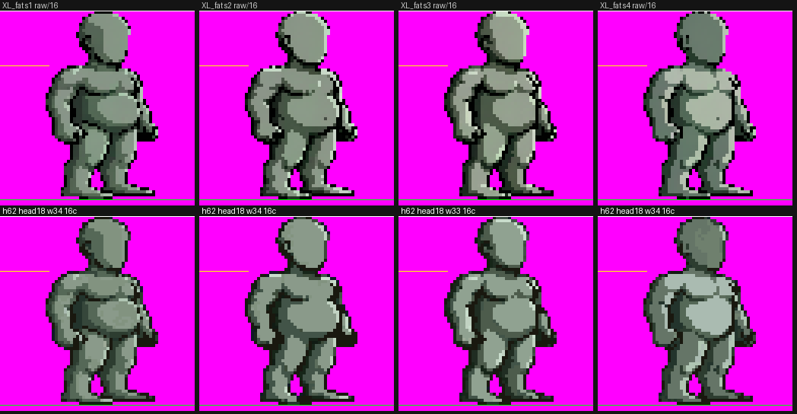
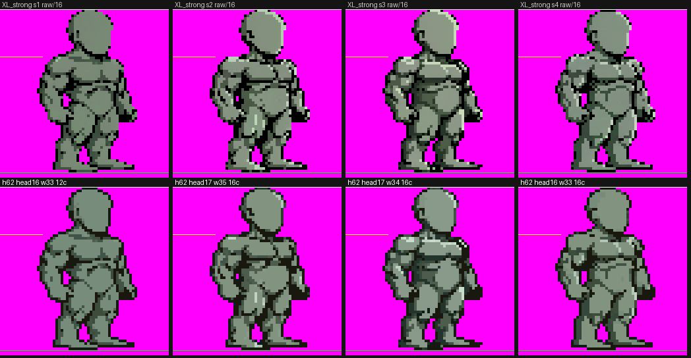

- **高度**：20 張全部命中規格。H3 照 Picture 1 的位置畫，腳底不用位移。
- **選圖理由**：
  - S seed 2 頭 14；seed 3 量到 15。
  - M seed 3 的頭頂多了一塊淺色帽狀色塊，所以選 seed 2。
  - L seed 3 的受光最清楚。
  - XL-胖 seed 2 肚子圓、亮面在左上。
  - XL-壯 seed 3 肩最寬、腰收得最明顯。4 個 seed 都沒有畫肚子；腹部是肌肉分塊，量出來的軀幹寬度和胖版差不多（34 vs 34），但看圖輪廓是倒三角。
- **XL-壯的頭量到 17**（規格 18）：粗壯的斜方肌把頸部窄段往上推，量法少算一列。參考圖本身是 18。
- **XL 頭頂碰到上緣**（y=0）：同第七輪，之後做持武器或跳躍時改用 64×72 畫布。
- 5 張全部 16 色，0 色超出 master.gpl。

### 4. `docs/ART_STYLE_SPEC.md`

- **視角**：人形（主角、隊員、霧屍、人台）3/4 側面，身體朝右、軀幹微轉向鏡頭；物件與動物純側面。
- **頭身**：加註 M 人台 3/4 側面寬約 24–28 px。
- **色數**：物件 ≤10 色；角色（人形、動物）≤16 色，識別色另計。驗收條也一併改。
- **XL 拆成 XL-胖、XL-壯**：
  - XL-胖：大肚子，用在 fatman、胖型巨屍。
  - XL-壯：寬肩厚胸、無肚子，用在 bruiser 型、壯型巨屍。
  - 隊員和巨屍的尺寸表同步改。

### 驗收

- [x] 色數規則：物件 ≤10、角色 ≤16＋識別色（樣板圖和人台都套用）
- [x] 阿凱棕髮和條紋恢復，56 高
- [x] 油桶紅漆＋大片鏽斑，21×31（28–31 內），用的是主色的紅
- [x] S／M／L／XL 改 3/4 側面，M 寬 27（24–28 內），身高、頭高不變
- [x] XL 拆成胖、壯，各 4 個 seed
- [x] ART_STYLE_SPEC 已更新
- [ ] 油桶紅偏鮭魚色、亮面不明顯，請審圖決定要不要在主色加高彩度紅

## 第七輪（STYLE_ANCHOR 續）：S／M／L／XL 無臉人台＋樣板圖修正

> 接第六輪（STYLE_ANCHOR）審圖意見，和下面的「第七輪（MELEE_WEAPONS）」是不同兩輪。

### A. 第六輪審圖修正

**1. 主角識別色**
- `master.gpl` 保留色從 8 色增為 10 色（48–57），新增兩個主角識別色，都取自現行 `akai_ai_idle.png` 的原值，不受飽和度 0.6 上限限制：
  - 球衣紅 `#ee333a`
  - 條紋藍 `#7a8cc0`
- 條紋藍原本就和第 47 號主色完全相同。現在改成多聚一群、再丟掉落在識別色上的那一群，讓 58 色互不重複。因為聚類重跑，主色有小幅變動：灰 13／綠 12／暖 9／紅 8／藍 6，L* 8.1–89.6。
- **每個物件只能用自己的可用色**：阿凱用主色 48＋識別色 2，其他物件只用主色 48。
  - 第一次重跑時沒有這條限制，油桶的橘紅被量化成球衣紅。
  - 保留色裡的血、火、UI 也不該出現在道具上，所以一併排除。
- 阿凱的紅 7 恢復成亮紅。條紋只剩幾條，是 H3 本來就只畫了幾條（量化前也一樣），不是量化造成的。

**2. 後處理新增（`pixelize.py`，人台共用）**
- **每個物件 ≤10 色**（`limit_colours`）：
  - 每次併掉「代價最小」的顏色：代價 = 像素數 × 到最近色的 OKLab 距離²，色相（a、b 軸）權重加倍。
  - 識別色和最暗色（外框）不會被併掉。
  - 原本的做法是「最少用的先併」，結果把阿凱的棕髮（17 px）併進了海軍藍的帽子。
- **清除 ≤2 px 孤立色塊**（`remove_islands`）：
  - 判斷孤立時，把 OKLab 距離 <0.06 的相近色視為同一塊。第一版只比對完全相同的顏色，結果木箱斜撐這種深淺交錯的線被當成雜點清掉；改了之後斜撐保住了。
  - 暗色（L < 0.35，外框、瞳孔）和識別色不處理。
  - 邊緣像素只取邊緣鄰居的顏色，所以外框不會斷。
- **油桶重跑**：提示詞把「少量小鏽斑」改成 `large flat rust patches, simple shapes, no small specks or noise`，跑 4 個 seed（`drum_seeds_x4.png`，白線 28、黃線 31）。
  - seed 2、4 把油桶畫成 41–45 高，淘汰。
  - **選 seed 3**：21×30，三道桶箍清楚，鏽斑是大片平塗，左上受光（+0.05）。
  - 只把油桶那一段合成進 seed 2 的樣板圖，其他物件沿用 seed 2。

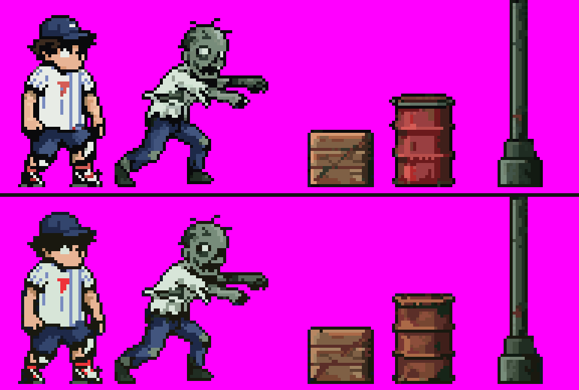

修正後的 `anchor.png`：

| 物件 | 尺寸 | 色數（前→後） |
| --- | --- | --- |
| 阿凱 | 29×57 | 14→10 |
| 霧屍 | 51×56 | 28→10 |
| 木箱 | 22×19 | 11→10 |
| 油桶 | 21×30 | 15→10 |
| 路燈 | 15×62 | 20→10 |

整張共 30 色，0 色超出調色盤。

**3. `docs/ART_STYLE_SPEC.md`**
- 油桶目標改成 19×28–31。
- 調色盤一行改成「48 主色＋10 保留色（UI／特效 8＋主角識別色 2）」，並註明道具和敵人只用 48 主色。

**取捨**：阿凱只有 10 色，其中 2 色是識別色，剩 8 色要分給帽子、膚色、白球衣、短褲、鞋、外框。頭髮的深棕跟外框暖黑 `#19180f` 太接近，最後併成同一色，所以頭髮看起來是深棕黑。如果要留住棕髮，需要讓主角放寬到 12 色，或把識別色排除在 10 色之外。

### B. 人台（AI_ART_PIPELINE §4.2）

輸出：`art/ai/mannequins/{S,M,L,XL}/side_stand_64.png`（另附 `_512`）。工具是 `tools/art/ai/build_mannequins.py`（refs → gen → post → pick），參數記錄在 `r7_meta.json`。

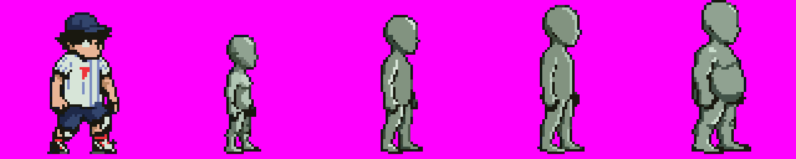

做法：
- **Picture 1**：從 M 側面人台（`M/profile/stand_512.png`，頸部在 y=22）切開，用 `make_mannequin_ref.py` 把頭和身體分開縮放，放到 1024 畫布（16 倍）。XL 的身體額外加寬，讓寬度是 M 的 1.4 倍。
- **Picture 2**：`anchor.png` 放大 5 倍，置中。
- **提示詞**：無臉、無髮、無衣物，純側面朝右、雙手下垂，畫風照 Picture 2（左上 45° 光、3–4 階陰影、1 px 外框右下較深、灰綠色調）。
- **後處理**：
  1. 偵測 16 px 格點相位，縮小 ÷16。
  2. 只留最大的一塊，腳底對齊 y=61。
  3. 只對 master.gpl 的 48 主色取色，補 selout 外框。
  4. 清 ≤2 px 孤立色塊，減到 ≤10 色。

| 體型 | 規格（高／頭） | 選定 | 實測高 | 實測頭 | 整體寬 | 軀幹寬 | 色數 | 受光差 |
| --- | --- | --- | --- | --- | --- | --- | --- | --- |
| S | 48／14 | seed 2 | 48 | 14 | 15 | 11 | 10 | +0.09 |
| M | 56／16 | seed 2 | 56 | 16 | 17 | 13 | 10 | +0.06 |
| L | 60／17 | seed 2 | 60 | 17 | 19 | 14 | 10 | +0.06 |
| XL | 62／18，寬 1.4× | seed 3 | 62 | 約 18（目測） | **24（M 的 1.41×）** | 22（M 的 1.69×） | 10 | +0.06 |

4 個 seed 的對照表：

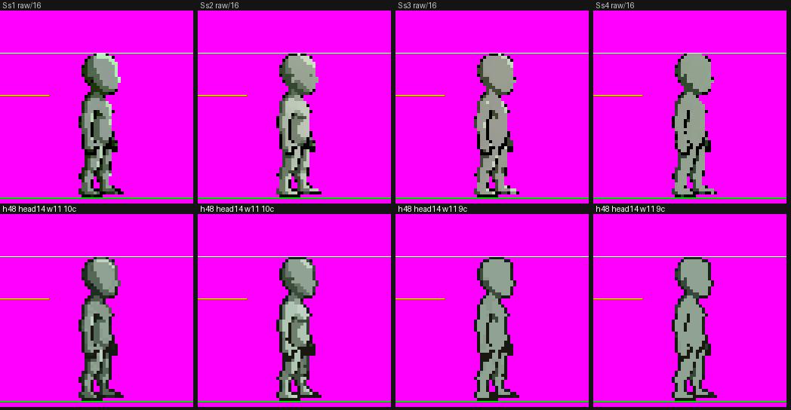
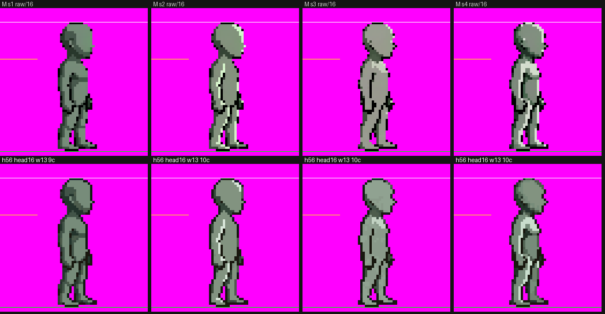
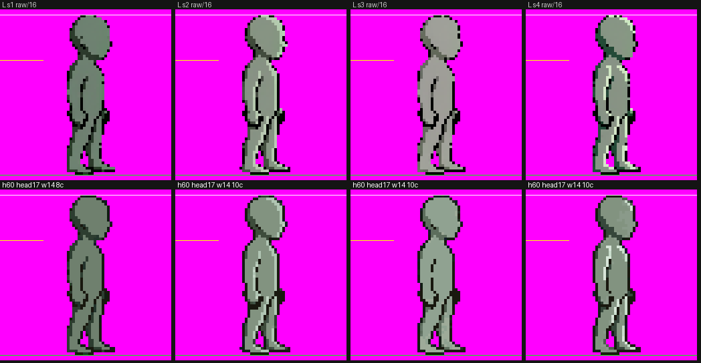
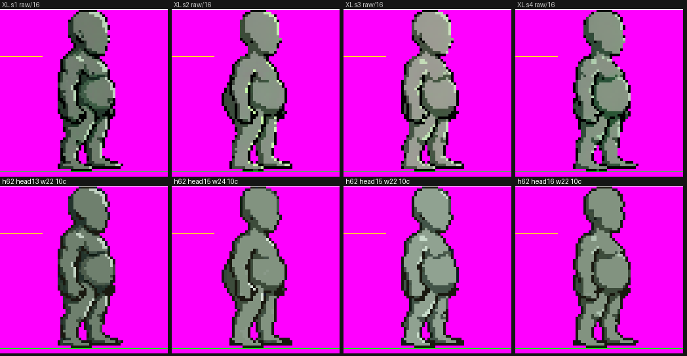

每張對照表上排是縮小 ÷16 的原圖，下排是後處理結果。綠線是腳底，白線是規格頭頂。

- **高度、頭高**：16 張全部準確命中規格。H3 完全照 Picture 1 的位置畫，腳底不用位移。
- **選圖理由**：S、M、L 都選 seed 2，畫法一致（左側亮邊、右側暗面、外框連續）。M seed 4 和 L seed 4 身上有白色亮紋；seed 3 的色調偏亮、偏平。
- **XL 的肚子**：4 個 seed 都畫出大肚子，軀幹寬是 M 的 1.69–1.85 倍，超過「寬 1.4 倍」。如果用整體寬度算，seed 3 是 1.41 倍，所以選它。
- **XL 頭高量不準**：量測腳本是「找最窄的一列當頸部」，但 XL 脖子太粗，量出 13–16。看圖頭部約 18 px，參考圖也是照 18 px 拼的。之後要改用頭部輪廓來量。
- **XL 頭頂碰到上緣**：62 高、腳底在 y=61，所以頭頂就在 y=0。以後加道具或做跳躍時，要改用 64×72 畫布。
- **人台比阿凱窄**：人台是純側面（照指示），M 寬 17；阿凱是 3/4 側面，寬 28。用人台換裝時，如果角色要 3/4 側面，要像第二輪那樣先把人台加寬。
- 4 張全部 10 色，0 色超出 master.gpl。

### 驗收

- [x] 主角識別色進 master.gpl（保留色 10 個），阿凱的紅 7 恢復
- [x] 每個物件 ≤10 色、清除 ≤2 px 孤立色塊（樣板圖和人台都套用）
- [x] 油桶重跑，21×30，落在新規格 28–31 內
- [x] ART_STYLE_SPEC 改油桶 28–31、保留色 10 個
- [x] S／M／L／XL 高度和頭高符合 §4.2（XL 頭高靠目測）
- [ ] XL 寬度：整體 1.41× 合格，但肚子讓軀幹寬到 1.69×，請審圖決定要不要壓肚子

## 第六輪（STYLE_ANCHOR）：主調色盤＋風格樣板圖

> 編號照 `docs/ai-art/STYLE_ANCHOR.md`（統一美術的第一步）。跟下面的「第六輪（AKAI_COMBO）」是不同的兩輪。本輪只做基準，遊戲裡的圖不換。

### 主調色盤 `art/ai/palette/master.gpl`

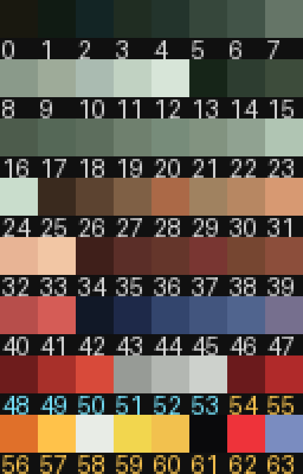

- 共 56 色：主色 48 色（0–47，依色系排、每組由暗到亮：灰 16／綠 9／暖 8／紅 8／藍 7），保留色 8 色（48–55：血紅暗、血紅、火光、火光亮、霧白、提示黃、UI 琥珀、UI 墨黑）。
- 來源：`akai_ai_idle.png`、`zombie_basic.png`、`refs/zombie_basic_palette.png` 的不重複色。每個來源權重相同，免得 1664 px 寬的霧屍條把色數吃光。
- **補了道具種子色**：木箱木頭、油桶鏽鐵、路燈鋼鐵各 4 階，權重 0.25。原本三個來源裡沒有這三種材質的顏色，不補的話道具只能拿膚色、褲子藍來湊。
- OKLab k-means（明度權重 1.5）→ 48 色。**來源色先夾到 L* 8–90 再聚類**：第一次先聚類再夾，結果有 5 個暗色同時被推到 L* 8.1、幾乎同色。另外飽和度上限 0.6，近中性灰往灰綠偏一點。
- 結果：主色 L* 8.2–89.6，飽和度最高 0.60。`palette.json` 記錄統計與參數。檢查指令：`python tools/art/ai/build_palette.py check <png>`。

### 風格樣板圖 `art/ai/style/anchor.png`（192×64，選 seed 2）

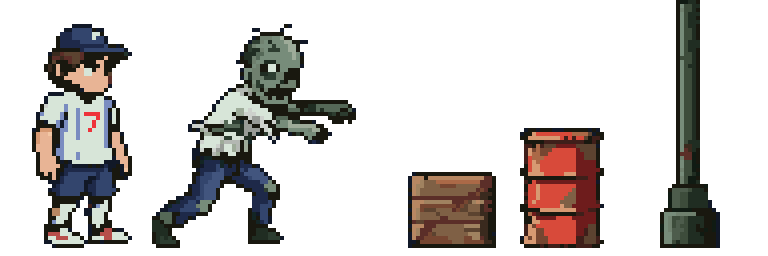

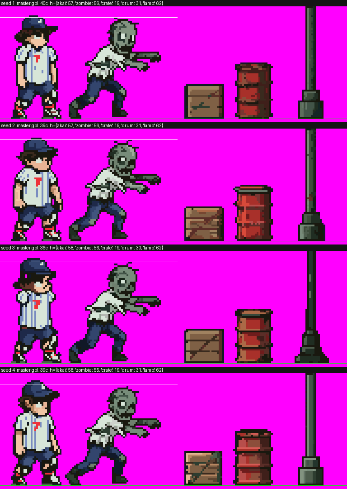

| 物件 | 目標 | 實測（seed 2） | 色數 |
| --- | --- | --- | --- |
| 阿凱 | 約 28×56，3.5 頭身 | 29×**57**，頭約 16 | 16 |
| 一般霧屍 | 56 高 | 51×**56** | 16 |
| 木箱 | 21×19 | 22×19 | 13 |
| 油桶 | 19×28 | 22×**31** | 16 |
| 路燈（下半段） | 寬約 14、64 高 | 15×62（頂到上緣） | 16 |

- **畫布改成 192×64**（文件寫 512×512）：五樣東西並排約 106 px 寬，放不進 64×64。仍照 8 倍規則：H3 生成 1536×512，縮小 ÷8。每個物件有自己的位置區段（`build_anchor.py` 的 `SLOTS`）。
- **三張參考圖**（新工作流 `h3_image_edit_3ref.json`）：
  - Picture 1：版面圖 `art/ai/style/layout_8x.png`，照目標尺寸擺好五樣東西。
  - Picture 2：`akai_ai_idle` 第 0 格，16 倍。
  - Picture 3：`zombie_basic` 第 0 格，16 倍。
  - 只有 Picture 1 時 H3 會照位置畫（同人台的經驗），所以尺寸和腳底線幾乎都由版面圖決定。
- **v1 → v2（阿凱頭身）**：v1 在版面圖的阿凱位置放 M 人台，但 H3 跟著 Picture 2 畫成大頭，阿凱 58–61 高（`anchor_seeds_v1_x4.png`）。v2 改在版面圖上直接放一張「3.5 頭身阿凱拼貼」：現行阿凱從頸部（y=23）切開，頭縮到 16 px，身體拉到 40 px。提示詞也改成「比例照 Picture 1，Picture 2 只取臉、服裝、配色」。改完阿凱 57–58 高，頭約 16 px。
- **後處理**：
  1. 偵測 H3 的 8 px 格點相位：4 個 seed 的偏移都不一樣，(3,1)、(4,0)、(6,2)、(5,4)。
  2. 洋紅去背，k-centroid 縮小 ÷8。
  3. 每個物件底邊對齊 y=61：H3 會差 1–2 列。
  4. 對 master.gpl 取色，清雜點，補 selout 外框。
  5. 每個物件減到 ≤16 色：最少用的顏色併進同物件內最近的顏色，最暗的外框色保留。
- 選 seed 2：阿凱 57 高、雙手自然下垂、臉最清楚，木箱左上受光最明顯。seed 3、4 的阿凱 58 高超出 ±1；seed 1 的頭髮和臉比較糊。
- `meta.json`：4 個 seed 的 seed、提示詞、參考圖、格點偏移、腳底位移、尺寸、色數。

### 驗收

- [x] 阿凱、霧屍腳底都在 y=61，高度 57／56（56±1）
- [x] 每個物件都有外框，亮面在左上。腳本量測：左上半與右下半的 OKLab 明度差都是正的（阿凱 +0.10、霧屍 +0.17、木箱 +0.10、油桶 +0.02、路燈 +0.04）
- [x] 全部 45 色都在 master.gpl 內（`build_palette.py check`，0 色超出），每個物件 ≤16 色
- [ ] 放進遊戲同框（雲端那邊做）

### 問題與後續

- **油桶 31 高**（目標 28）：4 個 seed 都是 30–31，H3 會在頂端多畫一圈桶緣。縮小像素圖會毀掉線條，所以沒有修，之後要的話改版面圖或重跑。
- **油桶飽和度**：塗裝紅偏亮，表面有鏽斑雜點，比其他物件「吵」。文件本來就允許可互動物件飽和度較高，不過紋理可以再收斂。
- **阿凱細節被調色盤吃掉一部分**：球衣直條紋只剩幾條；紅色 7 號受飽和度上限 0.6 限制，比現行版本淡。如果要保留，可以考慮把「主角紅」列進保留色。
- 霧屍 30 色減到 16 色後，衣服的灰階少一階，看不出明顯差異。
- 路燈柱上有一點鏽色（seed 2），算紋理，保留。

## 第八輪（MELEE_WEAPONS）：開山刀（machete）

輸出：`art/ai/out/akai_machete/`（朝右、`akai_v4/palette.png`，配色以 `akai_ai_melee.png` 為參考；`build_weapon.py` 產生，`picks.json` 可重跑）

| 檔案 | 畫格 | 格數 | 來源（seed／影片格號） |
| --- | --- | --- | --- |
| `akai_ai_idle_machete.png` | 64×72 | 4 | idle seed 2，自動挑循環，上半身固定 |
| `akai_ai_walk_machete.png` | 64×72 | 8 | walk seed 3，自動挑循環（週期 26 幀），上半身固定 |
| `akai_ai_melee_machete_1.png` 斜劈 | 64×72 | 6 | seed 2：7、9、22、27、31、35 |
| `akai_ai_melee_machete_2.png` 反手砍 | 64×72 | 6 | seed 1：4、5、11、13、28、33 |
| `akai_ai_melee_machete_3.png` 跳劈 | **64×80，腳底第 77 列** | 6 | 512×640 重跑的 seed 3：7、11、22、27、32、36 |
| `akai_ai_melee_machete_dash.png` 迴旋砍 | 64×72 | 6 | seed 1：6、8、9、10、18、32（第 2、3 格背對鏡頭） |

另有 json、contact、`compare_machete.png`、`machete_all.gif`（36 格，3 倍、12 fps、播一次停 0.5 秒）、`meta.json`、`picks.json`。生成腳本：`tools/art/ai/machete_videos.sh`。

做法同軍用刀：備戰關鍵格（H3 Image，Picture 2＝`weapon_machete_x8.png`，單手持刀舉在肩旁、左手護在前，seed 234；刀身約 16 px）→ 走路關鍵格（seed 242）→ 每個動作 4 seed 的 H3 影片 → `build_weapon.py`。

注意事項：
- **跳劈改成 64×80**：64×72 時，4 個 seed 跳起來舉刀的畫面全部超出上緣。文件只說斧和鎚的高舉格用 64×80，但跳劈也需要，所以這招改用 64×80（腳底第 77 列）重跑（備戰格上方補 8 列，影片 512×640）。即使如此，4 個 seed 裡只有 seed 3 沒被切到（H3 會把跳的高度撐滿畫面）。第 1 格是跳在空中（腳離地 4 px，保留）。這招不貼 7 號：蹲低和跳起的姿勢會讓頭落進球衣帶，第一次試時 7 號貼到了眼白上。
- **刀光**：提示詞明寫「no slash trails, no sparks, no flashes」，H3 還是在大部分揮刀格畫出白色弧光（開山刀本身就是一大片白色刀身，弧光又連在刀上，後處理分不開）。所以三招的命中格都是「刀已經揮到位」的那一格，沒有揮到一半的中間格。
- **迴旋砍**：背對鏡頭的兩格（影片第 9、10 格）腿部附近有少量紅色殘影；轉身時第 4 格刀下還有一小段弧光。轉到一半的其他格（第 11–15、19–27 格）不是被切到就是被大片弧光蓋住。
- 斜劈第 3 格刀尖落到第 71 列（低於腳底線 2 px，刀砍到地面）。

## 第七輪（MELEE_WEAPONS）：軍用刀（knife）

輸出：`art/ai/out/akai_knife/`（全部 64×72、朝右、腳底第 69 列、`akai_v4/palette.png`，配色以 `akai_ai_melee.png` 為參考）

| 檔案 | 格數 | 來源（seed／影片格號） |
| --- | --- | --- |
| `akai_ai_idle_knife.png` | 4 | idle seed 2，自動挑循環（週期 18 幀），上半身固定 |
| `akai_ai_walk_knife.png` | 8 | walk seed 4，自動挑循環（週期 26 幀），上半身固定 |
| `akai_ai_melee_knife_1.png` 刺 | 6 | seed 1：6、9、18、22、27、33 |
| `akai_ai_melee_knife_2.png` 連刺 | 6 | seed 4：12、15、17、20、29、33 |
| `akai_ai_melee_knife_3.png` 橫劃 | 6 | seed 2：7、10、19、22、27、32 |
| `akai_ai_melee_knife_4.png` 重戳 | 6 | seed 1：5、9、12、20、29、33 |
| `akai_ai_melee_knife_dash.png` 滑步突刺 | 6 | seed 2：8、10、13、22、29、33 |

另有：各自的 json（`frameHeight: 72`）、`contact_*.png`、`compare_knife.png`（七組並排）、`knife_all.gif`（42 格，3 倍、12 fps、播一次停 0.5 秒）、`meta.json`、`picks.json`（挑格設定，`build_weapon.py` 可直接重跑）。

做法：
1. **拿刀備戰關鍵格**：H3 Image 1024×1152，Picture 1＝持棒備戰姿勢（腳底已在第 69 列），Picture 2＝`weapon_knife_x8.png` 放大置中。提示詞要反手握刀、低身格鬥架式、左手護在前。4 張都可用，挑刀最清楚的 seed 212。刀身約 10 px。
2. **走路關鍵格**：從備戰格改成大步（4/4 可用，seed 222）。
3. **影片**：每招首尾幀＝備戰格（走路＝走路關鍵格），攻擊 39 幀、待機與走路 56 幀，各 4 seed，共 28 支（提示詞在 `tools/art/ai/knife_videos.sh`）。
4. **後處理**（新的 `tools/art/ai/build_weapon.py`，之後三把武器共用）：挑格 → 64×72 固定地面與中線（走路、衝刺改逐格對腳底，因為影片裡腳會往下飄 1 px）→ 對調色盤 → 保留外框 → 球衣與 7 號對齊第 1 招、補條紋 → 只留最大連通塊 → strip／json／contact，最後合成一支 GIF。

注意事項：
- **seed 3 的影片背景會閃橘／黃色**（七個動作都是），全部不用。
- **刀光特效**：H3 常在出手時加白色或淺藍的刀光、白色衝擊光、紅色火花。挑格時避開了：刺的第 10–17 格、橫劃的第 14–18 格（大片白色弧光）。所以「橫劃」的命中格是刀已經掃到右前方那格，沒有揮到一半的中間格。
- **刺與連刺的伸展幅度不大**：刀從胸前往前推約 8–10 px，縮到 1 倍時看得出是刺，但兩招的差別主要在身體轉向，不太明顯。
- **滑步突刺**第 1 格（往下蹲）臉部比較糊。
- 第一次載入後每支影片 25–33 秒；28 支約 15 分鐘。

## 第六輪（AKAI_COMBO）：鋁棒連擊第 2 招（右揮）、第 3 招（下揮）

輸出：`art/ai/out/akai_combo/`
- `akai_ai_melee2.png`、`akai_ai_melee3.png`：各 6 格、64×72，朝右、腳底第 69 列、舊版形象、`akai_v4/palette.png`（和 `akai_ai_melee.png` 同一套）
- `.json`（`frameHeight: 72`、12 fps、不循環）、`contact_*.png`（4 倍，綠線＝腳底）
- `combo.gif`：第 1、2、3 招接起來 18 格，3 倍、12 fps、只播一次，最後停 0.5 秒
- `meta.json`：兩招的首尾幀、提示詞、seed、挑的格號、說明

格位排法照文件：0–1 起手、2 命中（球棒在正前方）、3 揮到底、4–5 收招回備戰。

| 招 | 首幀 → 尾幀 | 長度 | seed | 挑格（影片格號） |
| --- | --- | --- | --- | --- |
| 2 右揮 | `akai_ai_melee` 第 3 格（揮過頭）→ 第 5 格（備戰） | 39 | 2 | 1、3、5、8、31、34 |
| 3 下揮 | 第 2 招第 3 格（seed 2 影片第 8 格原圖）→ 備戰 | 56 | 2 | 9、16、26、29、36、43 |

說明：
- **第 2 招**：4 個 seed 的動作都一樣：球棒從左後方往右前方掃過、揚到右上，之後有一段把球棒橫放在頭後的停頓（影片第 10–21 格），再回備戰。停頓那段不用。
- **第 3 招**：
  - 4 個 seed 都有「高舉 → 後仰蓄力 → 劈下 → 回備戰」。seed 2 後仰時前腳抬起，有跨步的感覺。
  - **球棒正上方高舉的那幾格（影片第 3–8 格）超出 72 px 畫布頂端**，生成時就被切掉，所以起手改用後仰、球棒在頭後的第 9、16 格（頂端還有 2 px）。如果要「正上方高舉」那一格，畫布要再加高（例如 64×80）。
  - 4 個 seed 劈下後球棒都落在身體左下方，沒有畫出「打到前方地面」，所以命中格用球棒水平在正前方的第 26 格，揮到底用球棒落到地面的第 29 格（棒尖低於腳底線 2 px，第 71 列）。
- **球棒碰到左右邊**：寬度固定 64，有幾格的球棒碰到 x=0 或 x=63（第 1 招的出手格也一樣）。
- **配色**：一開始照第四輪用 idle 當參考，但這兩招轉身時球衣陰影多，全被對到條紋色，整件變偏藍。改用第 1 招（`akai_ai_melee`）的畫格當參考，再補 idle 間距的條紋，三招的球衣顏色、條紋密度一致。
- 第一次呼叫 H3 影片花了 389 秒（模型要重新載入），之後每支 25–33 秒。

## 第五輪（ZOMBIE_REACT）：一般霧屍受擊、擊飛、爬起

輸出：`art/ai/out/zombie_basic/`
- `react.png`：11 格橫排、每格 64×64、透明底
- `contact_react.png`：4 倍、洋紅底、格號與動作名、綠線＝腳底 y=62
- `react.gif`：3 倍、12 fps、只播一次，最後一格多停 0.5 秒
- `react_regions.png`：`make_zombie_variants.py` 的 `classify()` 分區圖（上衣白、褲子藍、皮膚綠、外框黑、其他灰）
- `meta.json`：各段的首尾幀、提示詞、seed、挑的格號、每格邊界、用色數、各區像素數

| 格 | 動作 | 來源 |
| --- | --- | --- |
| 0–2 | 受擊 | H3 Image，以現有站姿（`zombie_basic_stand0_x8`）改姿勢，seed 203／203／201（見下方說明） |
| 3–4 | 擊飛 | A 段 seed 2，影片第 21、28 格 |
| 5–6 | 落地 | A 段 seed 2，影片第 36、48 格 |
| 7–10 | 爬起 | B 段 seed 1，影片第 3、12、33、51 格 |

**做法**：照第 3 節，H3 影片首尾幀分兩段，各 4 個 seed（512²、56 幀、8 步 turbo）。
- A 段（站姿 → 倒地 13）：第一版提示詞寫了「被球棒打」，4 個 seed 都把球棒畫進畫面。改成「畫面只有霧屍、無形的重擊」後，仍有 3 個 seed 短暫出現球棒；seed 2 只在影片第 6–9 格出現，之後的倒地過程乾淨，採用它。殘留的橘色像素用 `downscale --drop-warm` 去掉，再只保留最大的連通塊。
- **受擊 0–2 改用 H3 Image**：A 段的霧屍在被打之前會先站直（高 61–62 px，現有站姿 57 px），從走路切到受擊時會「長高」，第 2 格也接不回走路。所以改成以現有站姿為 Picture 1，用 H3 Image 做「頭往後甩」「上身後凹」「回到駝背站姿」三張（各 3 seed）。高度 57–58 px。H3 把褲子畫成較亮的牛仔藍，**在量化前**依明度分位數對應到現有第 0 格的褲子顏色（`pixelize.py region --parts pants`），否則硬性對色會把它對到灰色、分區變成「其他」。
- B 段（倒地 13 → 站姿）：seed 1 最清楚：撐起、坐起、單膝跪、站起。

**對齊**：影片鏡頭固定，所以不逐格對腳底（那樣擊飛格會被拉回地面）。整段用固定的來源地面（影片第 496 列、H3 Image 第 992 列）和固定中線，統一位移到腳底 y=62（`downscale --fixed-foot --fixed-center`）。擊飛的兩格保留離地高度。

**後處理**：洋紅去背 → ÷8 k-centroid → 硬性對到 `zombie_basic_palette.png` 的 70 色（`apply --keep-outline`，原圖已有外框）→ 只留最大連通塊。結果用到 69 色，**0 色超出調色盤**。

### 驗收

- [x] 11 格都朝右；站姿／跪姿腳底都在 y=62（第 0、1、2、7、8、9、10 格最低列 = 62）；躺姿背部 y=57–61；站姿高度 57、57、58、59 px（現有第 0 格 57，差 ≤ 2）
- [x] 分區正確：11 格都有完整的上衣、褲子、皮膚三區；上衣裡的綠色小點是破洞露出的皮膚，現有圖也一樣（已和現有第 0、11、13、14 格的分區圖比對）
- [x] 第 2 格和走路第 0 格幾乎一樣；第 10 格略直立、步幅較小，大小一致
- [ ] **第 6 格頭在左 ✓，但上身還微微抬起**，比較像現有第 13 格，不像第 14 格那樣完全平躺（A 段尾幀就是第 13 格）。若要完全平躺，可把 A 段尾幀換成第 14 格重跑
- [x] GIF：受擊 → 飛起 → 落地彈一下 → 躺 → 爬起，一次播完

### 要請雲端注意

- **腳底列差 1 px**：ZOMBIE_REACT 第 2 節規定腳底 y=62，這張照做；但現有 `zombie_basic.png` 每格的最低列是 y=61。在遊戲裡從走路切到受擊時，會往下移 1 px。可以在遊戲端對這張圖的原點加 1 px 位移，或告訴我改成 y=61 重出（只差最後的位移，不用重新生成）。
- 擊飛兩格的高度是影片裡的實際離地高度；如果 `Zombie.launch` 本身也會移動 Y，可能需要把這兩格對回地面，請依時間軸決定。

## 第四輪（REVIEW-04）：持棒待機／持棒走路、64×72、揮擊配色一致

輸出：`art/ai/out/akai_v4/`（`idle`、`walk` 沿用 v3，64×64；`idle_bat`、`walk_bat`、`melee` 為 **64×72、腳底 y=69**；各自 strip／json／gif／contact，`palette.png`，`meta.json`，六組並排 `compare_all.png`）。json 的 `frameHeight` 已依畫格寫 64 或 72。

| 動作 | 格數 | 做法 | seed |
| --- | --- | --- | --- |
| idle_bat | 4 | melee 預備姿勢（v3 的 `akai_meleeready`）補成 1024×1152 → H3 影片 512×576 首尾同幀 56 幀 | 2 |
| walk_bat | 8 | 同一張 → H3 Image 1024×1152 做「保持握棒、雙腿大步」關鍵格（4/4 可用）→ H3 影片首尾同幀，週期 26 幀 | 3 |
| melee | 6 | 預備姿勢補高時**腳底直接放在 y=69**（上 6 列、下 2 列）→ H3 影片 512×576 不接尾幀 39 幀；挑格 預備 8、14，出手 17，收招 21、26、31 | 3 |

**64×72 的做法**：只在後處理加高畫布不夠，因為 v3 的球棒在生成時就已經頂到 512² 影片的上緣。所以生成時就用 64×72 的比例（H3 Image 1024×1152、H3 影片 512×576），角色維持原大小。第一次只在上方補 8 列，結果腳底還是貼在畫布底，移到 y=69 時球棒又被推出去；改成補高時就把腳底放在 y=69（`pad_canvas.py --bottom 2`）後重跑 melee。4 個 seed 中 seed 2、3 最高點離頂端還有 2 px 以上，採用 seed 3。三組 64×72 的第 0 列都沒有不透明像素（沒有被切）。

**上半身鎖定**：idle_bat、walk_bat 用新的 `apply --lock-rows 51`，把第 0 格腳底以上的固定列（頭＋手＋球棒，到紅腰帶上方）貼到每一格，不跟著起伏，球棒不會抖；只有腿在動。melee 不鎖。

**揮擊配色與條紋（方案 a）**：新增 `pixelize.py harmonize`。
- 原圖球衣是白、灰、藍灰條紋 `#7A8CC0` 三層；v3 idle 量化後是 58% 白＋39% 條紋色。v4 的持棒版與 melee 球衣偏白，條紋落在較淺的 `#A2B7D8`（球棒加的 3 色之一），所以看起來淡。
- 在腳底往上 18–43 列的球衣帶裡，把淺色／偏藍的像素依明度排序、按比例（分位數）一對一對應到 idle 的球衣顏色。
- 持棒版和 melee 原始畫格的條紋本來就少，對應完仍有大塊純白，所以再用 idle 的條紋間距（「條、白、條、白、白」5 px 一組，以中線 x=32 為基準）補在純白、非外框的球衣上（`--stripe-pattern 10100`）。
- 7 號：從 idle 第 0 格取 7 的紅色像素，依每格紅色區塊的位置平移貼上，原本的 7 先改成球衣白；只貼在球衣上，不會貼到手臂（第一次試時揮棒收招格的 7 貼到手臂皮膚上，已修正）。三組每一格都有貼。
- 結果見 `compare_all.png`：五組的球衣條紋密度、顏色、7 號位置一致。

## 第三輪（REVIEW-03）：舊版阿凱形象＋idle／walk／melee

輸出：`art/ai/out/akai_v3/`（`idle`、`walk`、`melee` 的 strip／json／gif／contact，`palette.png`，`meta.json`，對照圖 `compare_oldlook.png`）。

**參考圖**：資料夾裡只有 `akai_oldlook_x4_preview.png`（256²、透明底）。確認它是 64×64 原圖的精確 4 倍放大（每個 4×4 區塊同色）後，無損還原出 `akai_oldlook_64.png`，再做 `_x8`、`_x16`（洋紅底）。都放在 `art/ai/refs/`。原圖：高 60 px（y=4–63）、62 色。

| 動作 | 格數 | 做法 | seed | 結果 |
| --- | --- | --- | --- | --- |
| idle | 4 | H3 Image「移除雙臂與手槍，其他不變」（4/4 可用）→ H3 影片首尾同幀 56 幀 | 3 | 頭＋軀幹鎖定（頂端 42 列，到紅腰帶上方） |
| walk | 8 | 無手臂圖 → H3 Image 大步關鍵格（4/4 可用）→ H3 影片首尾同幀 56 幀，週期 26 幀 | 1 | 同上鎖定；步幅大、雙腿交替清楚 |
| melee | 6 | 原圖 → H3 Image「雙手握球棒、預備姿勢」（3/4 可用；1 張胸前出現兩個 7）→ H3 影片不接尾幀 39 幀 | 4 | 手動挑格：預備 9、13，出手 17，收招 20、24、28。不鎖 |

後處理：
- 調色盤：直接用 `akai_oldlook_64.png` 的 62 色，另加 3 色（k-means，只取和原色差很多的像素＝球棒木色）共 65 色。新增 `pixelize.py palette --base <圖> --extra N`。
- 外框：原圖已有黑色粗外框，`apply --keep-outline` 不重新上色。
- 條紋：縮小後還在，不另畫。
- 腳底：每格 y=61（原圖在 63，往上移 2 px）。

注意事項：
- **頭頂空間只有 2 px**：原圖 60 px 高，腳底移到 y=61 後頭頂在 y=2。走路的過渡姿勢身體會升高 2–3 px，帽子會碰到畫布頂端；鎖定上半身時頭部取自完整的第 0 格，所以帽子不會被切掉，起伏最多 2 px。
- **melee 球棒舉高時（第 0、4、5 格）球棒尖端超出畫布頂 1–2 px，被切掉**。如果要完整，需要比 64 高的畫格（例如 64×72），或讓 melee 的腳底留在 y=63；請雲端那邊決定。
- **melee 看起來比 idle 大**：用 512 原始畫格量帽寬，中位數三個動作都是約 12 px，比例相同；看起來大是因為蹲低、站得開、頭轉得比較正面。
- **球衣比原圖白**：H3 把球衣畫亮了，量化後對應到原調色盤裡較亮的白色。melee 預備格的條紋較不清楚、7 號較方塊。
- 調色盤用了原圖的 62 色＋3 色，所以每個動作實際用到 56–64 色（第一、二輪的 ≤16 色規則這輪不適用，REVIEW-03 指定沿用原圖配色）。

## 第二輪修正（REVIEW-02）

| 意見 | 處理 | 結果 |
| --- | --- | --- |
| 1. 臉前緣是暗紅外框（`#7B1111`） | `pixelize.py` 外框改為「只從同色系挑較暗色」：彩色像素只找色相差 30° 以內的較暗色，白／灰只找中性較暗色，找不到才用外框黑。調色盤保留深膚色 `#8A4A2A` | 頭部（頂端 17 列）紅色像素：12 格全部 0。臉前緣是深膚色 |
| 2. 純側面太扁 | 人台改 **3/4 側面**（`three-quarter view facing right, chest slightly turned toward camera`），再橫向加寬（身體 ×1.3、頭 ×1.1）後讓 H3 重畫。比例 56 px／3.5 頭身／腳底 y=61 不變 | 站姿寬 28 px（現有主角約 28 px）；無手臂 23 px。舊的純側面模板移到 `art/ai/mannequins/M/profile/` 保留 |
| 3. 調色盤有 4 個近黑色 | `pixelize.py palette` 把 OKLab L<0.25 的像素合併成 **1 個外框黑**，另保留深膚色、條紋色，其餘 13 色做 k-means | 16 色：`#030505`（唯一近黑）、深藍 ×4（帽、褲明暗）、`#8A4A2A`、`#D40B0B`、灰 `#70777A`、條紋 `#7C8AA8`、膚 ×2、白衣 4 階（`#ACB7C1`→`#FAFCFC`） |
| 4. 條紋 | `pixelize.py apply --stripes 17:35`：球衣區（頭頂往下 17–34 列、中性淺色、非外框）每 3 px 畫一條 `#7C8AA8` 直線，以中線 x=32 為基準，各格不會漂 | 條紋清楚，7 號與外框不受影響 |

3/4 版重做流程：3/4 人台 → 無手臂 → 走路大步關鍵格 → 阿凱設定稿（4/4 可用，挑 seed 133）→ 阿凱走路關鍵格（4/4 可用，挑 seed 143）→ idle／walk 影片各 4 seed（idle 挑 seed 2、walk 挑 seed 3）。

### PixelForge-H3 試用（REVIEW-01 第 4 點）

節點已安裝（`blubs-pixel-nodepack`，28 個節點；另裝 bunnyUFO `comfyui_workflows_utils`，28 個節點，需 `pixeloe`、`potracer`）。用 `art/ai/workflows/pf_post.json`（Chroma Key flood → Temporal Stabilize despike → Quantize 64 px／16 色／共用調色盤）處理同一批 walk 畫格，和自寫腳本並排：

| | 自寫 `pixelize.py` | PixelForge（預設參數） |
| --- | --- | --- |
| 速度 | 約 5 s（CPU） | 1 s |
| 腳底 y=61 | ✓ | ✓（沒用 Auto-Crop，畫格已按規格擺好） |
| 去背 | ✓ | ✗ 兩腿之間殘留洋紅（flood 只去掉連到邊緣的背景） |
| 色彩 | ✓ | ✗ 第 0、7 格臉變灰綠（映射到錯的色） |
| 7 號、臉閃動 | ✓（上半身鎖定） | ✗ 每格不同 |
| 條紋、外框規則 | ✓ | 無 |

結論：後處理**繼續用自寫腳本**。PixelForge 的 `key` 方法、`temporal_lock` 等參數還沒調，之後如果要給其他角色用可再試。bunnyUFO 的 `sprite-from-prompt-h3` 在 768² 需約 21.7GB VRAM，這輪沒跑。

## 結果

| 角色 | 動作 | 品質 1–5 | 重抽次數 | 耗時 | 問題 |
| --- | --- | --- | --- | --- | --- |
| 阿凱 | idle（4 格，3/4） | 4 | 0（4 seed 挑 1） | 設定稿 4×15–30 s ＋ 影片 4×30 s | 呼吸動作小（遊戲有程式化呼吸，OK） |
| 阿凱 | walk（8 格，3/4） | 4 | 0（4 seed 挑 1） | 關鍵格 4×15–30 s ＋ 影片 4×30 s | 7 號在 64 px 筆畫較粗糙 |

輸出：`art/ai/out/akai/`（`idle.png/json/gif`、`walk.png/json/gif`、`contact_*.png`、`palette.png`、`meta.json`）。

第一輪（純側面）的流程如下，第二輪只換成 3/4 人台與上面的後處理修正：
1. 設定稿：H3 Image，Picture 1 = 試跑時的阿凱換裝圖、Picture 2 = 無手臂人台 → 無手臂阿凱（4/4 都可用，挑 seed 71）。
2. 走路關鍵格：H3 Image，Picture 1 = 無手臂阿凱、Picture 2 = `walk_contact_a` 人台（4/4 可用）。
3. 影片：H3 影片，首尾同幀（idle 用設定稿、walk 用大步關鍵格），56 幀。提示詞加 `long strides, legs clearly alternating, knees lifting, heel strike and toe push-off`（無手臂版不加 `arms swinging`）。**步幅問題解決**：腿明顯交替、跨步大。
4. `pick_frames.py loop`：自動找最能接回的週期（walk 週期 27 幀＝兩步），平均取 8 格／4 格。
5. `pixelize.py`：洋紅去背 → 對齊（同一動作共用水平中線、每格腳底對 y=61）→ ÷8 k-centroid → idle＋walk 共用 16 色 OKLab 調色盤 → 清孤立點、補外框 → **上半身鎖定**（見下）。
6. `build_sheet.py`：strip／json／contact（4×，含基準線）／GIF。

## 驗收清單

- [ ] 阿凱與霧屍並排（`compare_lineup.png`）— 霧屍下一輪
- [x] 所有格的支撐腳都在 y=61，循環動作不上下抖、不左右飄（`meta.json` 的 `foot_rows` 全為 61；水平中線整個動作共用）
- [x] 每個角色 ≤ 16 色，播放不閃色（idle＋walk 共用一組 16 色）
- [x] 放大 4 倍看：外框連續、沒有孤立雜點、沒有殘留洋紅（目視 contact）
- [x] 阿凱認得出：深藍帽、紅色 7 號、白色條紋球衣（條紋由腳本畫）
- [ ] 無手臂版的肩膀位置在各格一致 — 上半身鎖定後一致，待 WeaponRig 實測
- [x] 每個動作的姿勢讀得懂（walk 1 倍大小看得出在走；idle 幾乎靜止）
- [ ] H3 設定比較表（pixelart8x LoRA 有／無、倍率、循環方式）— LoRA 找不到、節點未裝，下一輪
- [ ] 全部角色時間估算 — 見「建議」初估

## 問題與處理

- **紅 7 與臉每格閃動**：影片每格重畫細節，量化後 7 的筆畫、眼睛每格不同。無手臂版的上半身在側面走路時是剛體，所以 `pixelize.py apply --headlock 34` 把第 0 格的頭＋軀幹（頂端往下 34 列）貼到每一格，跟著每格的上下起伏移動；腿保留影片原本的動作。閃動消失。**限制**：有手臂的動作（melee／hit／death）不能這樣鎖，之後要另想辦法（只鎖頭，或鎖 7 號的區塊）。
- **條紋消失**：原圖條紋約 4 px 寬（512 空間），縮 8 倍後不到 1 px。建議比照 `HeroArt.ts` 由程式在 64 px 上畫條紋，或 H3 提示詞要求「粗條紋、間距 2 px」再試。
- **headlock 被雜點帶偏**：一開始用每格最上面一個不透明像素對位，帽子上方一個雜點會讓頭錯位；改為「第一列有 ≥3 個像素」。
- **輸出路徑**：依新規格改為 `art/ai/out/<角色>/`。
- **H3 Image 官方範本**的提示詞擴寫步驟已移除；`h3_image_edit.json` 加了可選的第二張參考圖（`load2`，不用時 `--set cond.images.image_2=null`）。
- **pixelart8x LoRA、PixelForge-H3、bunnyUFO 節點**：見上方「H3 配套」。
- **模型清理**：本機模型資料夾與使用者其他 ComfyUI 專案共用，只刪本輪為路線 A 下載的 15 個檔案（依檔案大小合計約 81.9 GB；刪除前後 C 槽剩餘空間只差 46 GB，可能同時有其他寫入）。H3 主線模型與其他專案的檔案都沒動。
- **pixelart8x LoRA**：使用者決定這輪不用 LoRA（H3 原始輸出縮到 64 px 已夠乾淨），等 idle／walk 確認後再評估。

## 建議

- H3 已可產出可用的 idle／walk：設定稿與關鍵格 4/4 可用，影片 4 seed 都可用、只是挑最穩的。
- 時間初估（熱機、每動作 4 seed）：設定稿約 2 分鐘＋每個循環動作約 2–3 分鐘＋每個短動作（6 格關鍵格）約 4–6 分鐘＋後處理與挑選約 5 分鐘。一個角色全套（12 個動作）約 1–1.5 小時機器時間；18 隊員＋3 主角＋7 霧屍約 30–40 小時機器時間，人工審圖另計。
- 下一輪：裝好 PixelForge-H3／bunnyUFO 節點比較後處理；找到 pixelart8x LoRA（或改試上列替代品）做有／無比較；做霧屍與短動作。

## 附錄：路線 A 試跑（已停止，僅供參考）

| 模型 | 解析度 | 耗時（熱） | VRAM 峰值 | 結果 |
| --- | --- | --- | --- | --- |
| Qwen-Image-Edit-2511 int8 ＋ Lightning 4 步 | 1024² | 11 s（單圖）／17 s（雙圖） | 15.4 GB | 換裝品質好；但**放到人台上 4 張只有 1 張可用**（臉朝左、7 號畫到背後、長出手臂）；人台放在 Picture 1 時完全不換人，要角色在前、姿勢在後才行 |
| FLUX.2 klein 4B ＋ 像素 LoRA | 1024² | 5 s | 15.0 GB | 寫實比例（約 7 頭身）、背景不是純洋紅，只能當概念圖 |
| Wan 2.2 I2V 14B ＋ lightx2v | 512² / 49 幀 | 44.5 s（冷） | 15.1 GB | 跑通，未完成比較即停止 |

結論與 REVIEW-01 一致：H3 的指令遵循與一致性明顯較好。
