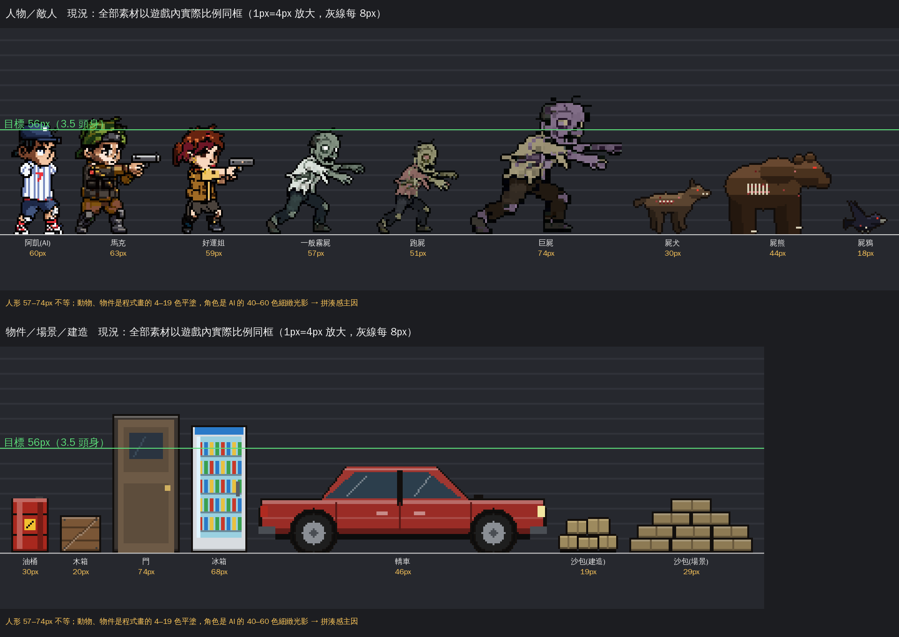
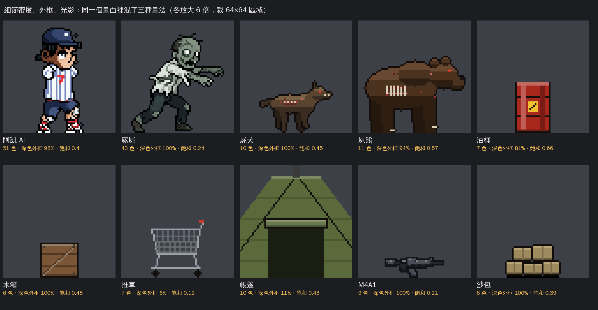
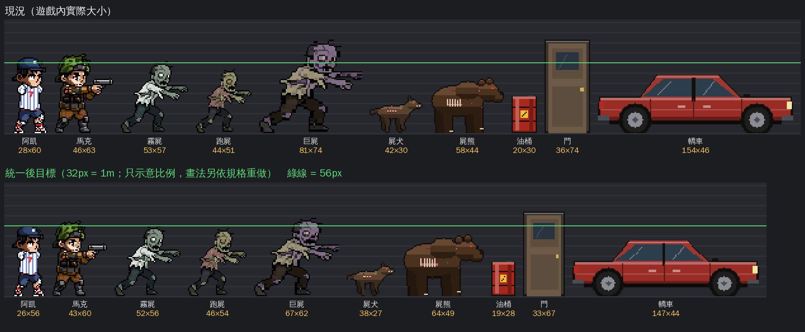

# 全遊戲美術統一規格（交給 H3 的生成規格）

> 2026-11-24 盤點。目的：消除人物、敵人、物件、場景、道具、武器之間的「拼湊感」。
> 角色細節流程沿用 [`AI_ART_PIPELINE.md`](AI_ART_PIPELINE.md)；本文件定的是**所有素材共用**的規則。

## 1. 拼湊感從哪來（量測結果）

| # | 問題 | 量到的數字 | 影響 |
| --- | --- | --- | --- |
| 1 | **細節密度差 5–10 倍** | 角色（AI／PixelLab）40–60 色、有柔和光影；動物 10–11 色；物件 4–19 色平塗 | 最主要的拼湊感：角色像一套遊戲，箱子、車、狗像另一套 |
| 2 | **人形高度不一** | 阿凱 60、馬克 63、好運姐 59、霧屍 57、跑屍 51、**巨屍 74**（再乘體型 ±10%） | 規格是 56 px，實際沒有一個是 56 |
| 3 | **頭身比不一** | 阿凱（AI）大頭偏 Q 版；隊員底圖與霧屍比較寫實 | 主角站在隊員、霧屍旁邊像不同畫師 |
| 4 | **比例尺錯位** | 物件用「60 px = 175 cm」換算（34 px/m）；新規格 56 px 應是 32 px/m | 門、車、冰箱都比角色大約 6% |
| 5 | **外框不統一** | 角色、武器 95–100% 深色外框；推車 6%、帳篷 11%、營火 0%、旗桿 4%、病床 34% | 沒外框的物件像貼紙，從背景浮出來 |
| 6 | **光源方向不一** | AI 角色左上光；程式物件（`Painter.box`）頂光＋底暗、左右一樣亮；動物橢圓頂光 | 同一盞路燈下，影子方向各說各話 |
| 7 | **同一東西兩種畫法** | 建造的沙包 32×19 與場景沙包 66×29 樣式不同；選角畫面的阿凱（隊員底圖改色）≠ 遊戲裡的阿凱（AI） | 玩家會直接注意到 |
| 8 | **圖示三種格子** | 掉落圖示 7×7、HUD 圖示 9×10、事件卡圖示 12×12，各自外框規則不同 | UI 看起來東拼西湊 |
| 9 | **武器誇張比例不一** | 手槍 15 px（實物 2 倍）、刀 15 px（1.5 倍），長槍約 1:1，球棒反而 0.86 倍 | 拿刀比拿球棒顯眼 |

## 2. 統一規格表

| 項目 | 規格 |
| --- | --- |
| 畫面 | 640×360 邏輯解析度，整數倍放大，**不做任何非整數縮放** |
| 比例尺 | **32 px = 1 m**（標準成人 56 px ≈ 175 cm） |
| 視角 | 純側面（橫向捲軸）。物件可露**頂面 2–4 px**（箱子、車頂、櫃子），不畫正面透視 |
| 像素密度 | 所有素材同一密度：1 遊戲像素 = 1 素材像素。**禁止**把大圖縮小或小圖放大後放進遊戲（目前霧屍、主角靠 `setScale` 1.04–1.3 調大小，要改成畫對尺寸） |
| 頭身 | 人形 3.5 頭身；頭 16 px（S 14、L 17、XL 18） |
| 外框 | 1 px 外框，**一律要有**。顏色用 selout：外框取鄰近色的最暗階，不用純黑；底部與背光側（右下）比亮側深 |
| 光源 | **左上 45°**。亮面在左上、暗面在右下；每個體積至少 3 階（亮／中／暗），最多 4 階 |
| 陰影 | 落地影子不畫在圖裡，統一由程式 `Fx.attachShadow()` 加 |
| 調色盤 | 全遊戲一張 **48 色主調色盤**（灰綠末日色調）＋ 8 色保留給 UI／特效（血紅、火光、霧白、提示黃）。每個素材 ≤ 16 色 |
| 明度範圍 | 最暗色不低於 L*≈8（夜晚會再壓暗）；主體最亮不超過 L*≈90，只有高光點可用 |
| 飽和度 | 環境與霧屍低飽和（≈0.15–0.35）；主角、可互動物件（油桶、補給箱）、危險物可較高（≤0.6），用飽和度引導視線 |
| 抖色 | 不用大面積抖色；只允許在天空、遠景霧用 |
| 畫格 | 人形 64×64（持近戰武器 64×72），腳底 y=61（72 高的是 y=69），中線 x=32 |

### 2.1 體型與尺寸表（32 px/m）

| 類別 | 目標尺寸（寬×高 px） | 現況 | 說明 |
| --- | --- | --- | --- |
| 主角、隊員 M | 約 28×56 | 59–63 | 用人台 M |
| 隊員 S／L／XL | 48／60／62（XL 寬 1.4 倍） | 程式拉伸 | 用人台，不再 `setScale` |
| 一般霧屍 | 56 高 | 57 | M |
| 跑屍 | 54 高、偏瘦 | 51（縮 0.9） | M 瘦版 |
| 巨屍 | 62 高、寬 1.4 倍 | **74**（放大 1.3） | XL，重畫而不是放大 |
| 屍犬 | 約 38×27 | 42×30 | 大型犬，肩高 0.6 m |
| 屍熊 | 約 64×48（四足）、人立 80 高 | 58×44 | 要比人有壓迫感 |
| 屍鴉 | 24×18 | 24×18 | 可讀性下限，保留 |
| 油桶 | 19×28 | 20×30 | 0.88 m |
| 門 | 34×67 | 36×74 | 2.1 m |
| 轎車 | 147×46 | 154×46 | 4.6 m |
| 冰箱 | 28×58 | 30×68 | 1.8 m |
| 槍械（手持） | 長槍 1:1；手槍、刀、彈匣等短物件**最少 12 px 長**，誇張倍率統一 ≤ 1.5 | 見 §1 #9 | 可讀性優先但要一致 |
| UI 圖示 | 統一 **12×12**（小格 HUD 用同一張縮到 2 倍整數顯示，不另畫 7×7） | 7×7、9×10、12×12 | |

## 3. 各類素材要調整的項目

### 人物（主角、隊員）
- [ ] 做 S／M／L／XL 四個人台（已在 AI_ART_PIPELINE §4.2），**頭 16 px 鎖死**，阿凱改回 3.5 頭身（目前偏大頭）。
- [ ] 主角三人、隊員 18 位底圖都在人台上換裝重做，取消 `crewPaint` 的拉伸與 `heroBuild` 縮放。
- [ ] 選角畫面、主選單、劇情卡改用同一套 H3 圖（現在選角的阿凱和遊戲裡長得不一樣）。
- [ ] 每個角色 ≤16 色、全部取自主調色盤。

### 敵人：霧屍
- [ ] 一般霧屍在 M 人台上重做（56 px），跑屍 M 瘦版、巨屍 XL 版各自生成，**拿掉 `def.scale` 的放大**（只保留 ±4% 的隨機高矮）。
- [ ] 分區顏色（上衣淺灰、褲子藍灰、皮膚灰綠、外框近黑）照 ZOMBIE_REACT 規格保留，`ZombieComposer` 換色才能繼續用。
- [ ] 調色盤從現在的 70 色收斂到 ≤16 色＋換色區塊。

### 敵人：動物
- [ ] 屍犬、屍熊、屍鴉從程式幾何圖改成 H3 生成，同樣左上光、selout 外框、3–4 階陰影。
- [ ] 尺寸照 §2.1；影格順序與 `ANIMAL_FRAMES` 相同就能直接換（犬 9 格、鴉 7 格、熊 9 格）。

### 物件（場景道具、建造物）
- [ ] 全部 70 種道具換算成 32 px/m（約縮 6%），`PX_PER_M` 改 32。
- [ ] 補外框：推車、帳篷、營火、旗桿、點滴架、病床、紐澤西護欄、垃圾袋、瓦礫。
- [ ] 光影改左上光：`Painter.box()` 加「右側暗一欄」，H3 重做的則直接照規格。
- [ ] 建造的沙包與場景沙包用同一張圖；路障、砲塔、路燈與場景物件同色階。
- [ ] 可互動物件（油桶、補給箱、門、保險絲盒）飽和度稍高，其他壓低。

### 場景（背景、建築立面）
- [ ] 遠景、中景用低飽和、低對比，不畫外框（和前景物件區分）；**近景立面**要有外框、左上光，和物件同一套。
- [ ] 前景路面不放細節雜點，讓角色剪影清楚。
- [ ] 章節插圖、事件卡插圖、主選單背景改用同一調色盤與光源。

### 道具（用品、掉落、圖示）
- [ ] 手雷已移除（本 PR）。用品剩醫療包、開鎖工具、噪音誘餌。
- [ ] 三套圖示合併成一套 12×12（`theme.ts`、`ZombieDrops`、`EventArt`），同外框、同調色盤。

### 武器
- [ ] 保留 `weaponMaps.ts` 字串像素圖＋WeaponRig（尺寸太小，AI 做不準）。
- [ ] 依 §2.1 調整誇張倍率：手槍、刀縮到 12–13 px，球棒、大錘加長到實物比例。
- [ ] 顏色改用主調色盤，光源改左上（現在是上亮下暗）。
- [ ] 近戰武器的揮擊影格已由 H3 畫進角色裡（阿凱），其他角色照同法。

## 4. 建議

### 4.1 生成順序
1. **主調色盤＋風格樣板圖**：先讓 H3 出一張「阿凱＋霧屍＋木箱＋油桶＋路燈」同框的樣板，確認後當之後**每次生成的參考圖**（H3 可放 16 張參考）。這一步最重要，後面全部對它看齊。
2. **人台 S／M／L／XL**。
3. **主角 3 人** → **一般霧屍** → 跑屍、巨屍（螢幕上最常出現）。
4. **防守據點畫面的物件**（路障、沙包、油桶、車、路燈、據點建築），這是玩家看最久的畫面。
5. 動物 3 種。
6. 隊員 18 位底圖。
7. 探索場景物件與立面，最後是插圖、事件卡。

每一步完成就接進遊戲錄一張同框截圖，和樣板圖比對再往下。

### 4.2 交給程式、不交給 H3 的
| 項目 | 原因 |
| --- | --- |
| 霧屍、隊員換色變體 | `ZombieComposer`、`crewPaint` 已能執行期換色，H3 只要出底圖 |
| 外框、selout、調色盤對色、去雜點 | 後處理腳本統一做，比提示詞穩定 |
| 落地影子、夜晚調色、燈光 | 程式疊加，素材本身不畫 |
| 血、斷頭、碎片、特效 | 程式物理比較有打擊感（`Fx.ts`、`ZombieGore`） |
| 物件損壞階段 | 完好圖由 H3 出，裂痕、焦黑用遮罩程式疊，避免每階段長得不一樣 |
| 武器、UI 圖示 | 12–40 px 太小，AI 生不準，維持字串像素圖，只統一調色盤與光源 |

### 4.3 驗收（每批素材都做）
- 和樣板圖放同一張截圖：高度誤差 ≤ 2 px、外框連續、光源同向。
- 每個素材 ≤16 色且全部在主調色盤內（腳本自動檢查）。
- 白天、夜晚各截一張，夜裡剪影仍讀得出來。
