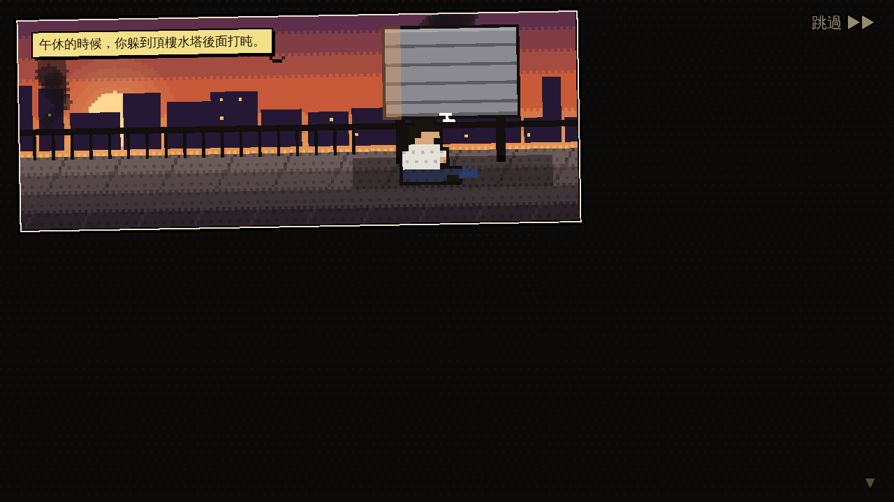
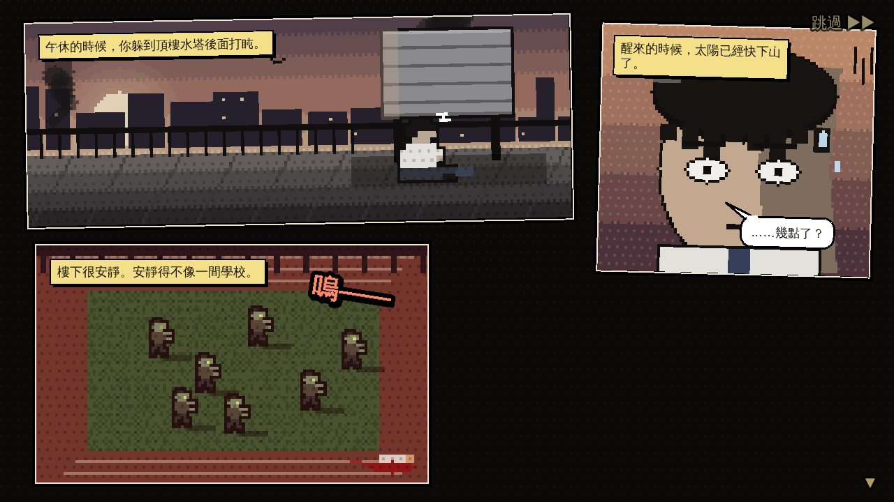
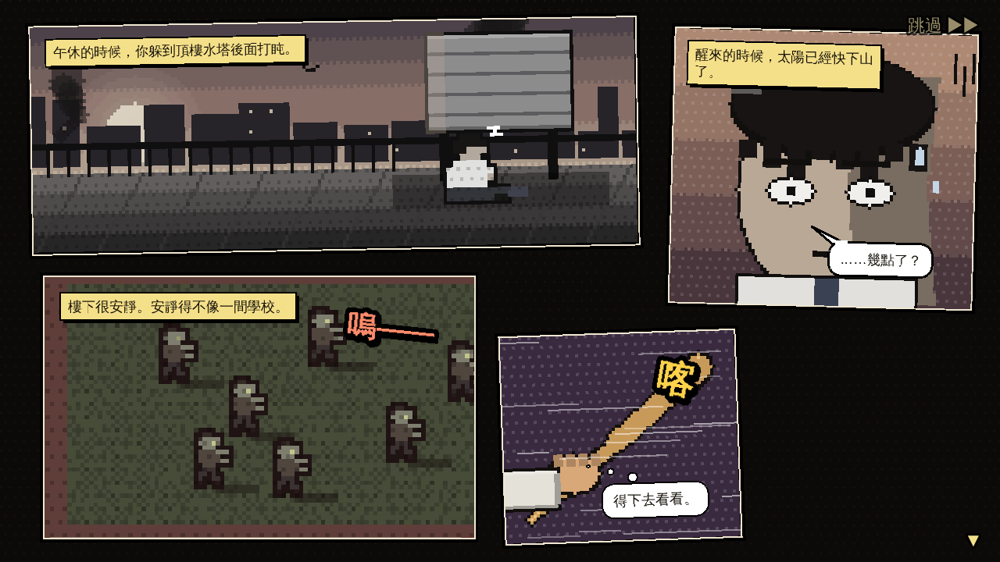
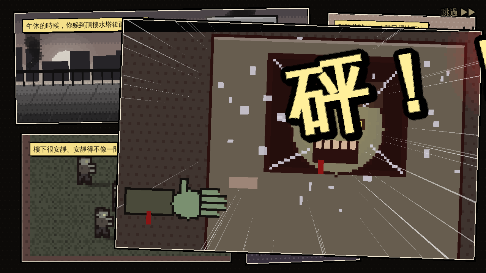
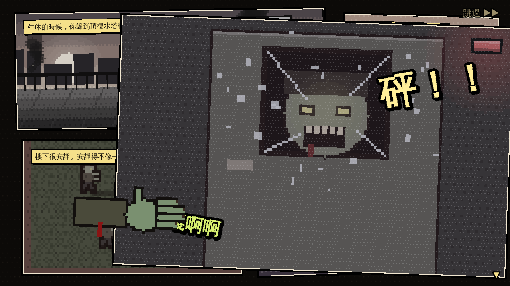
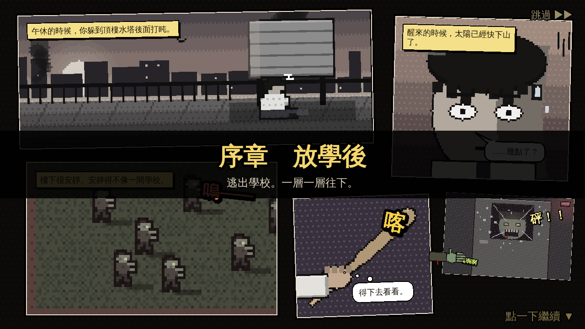
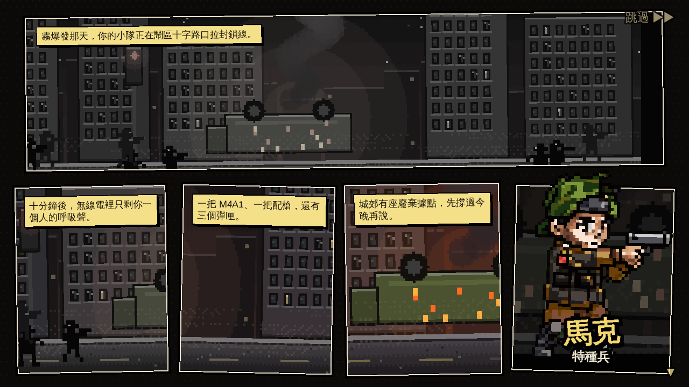
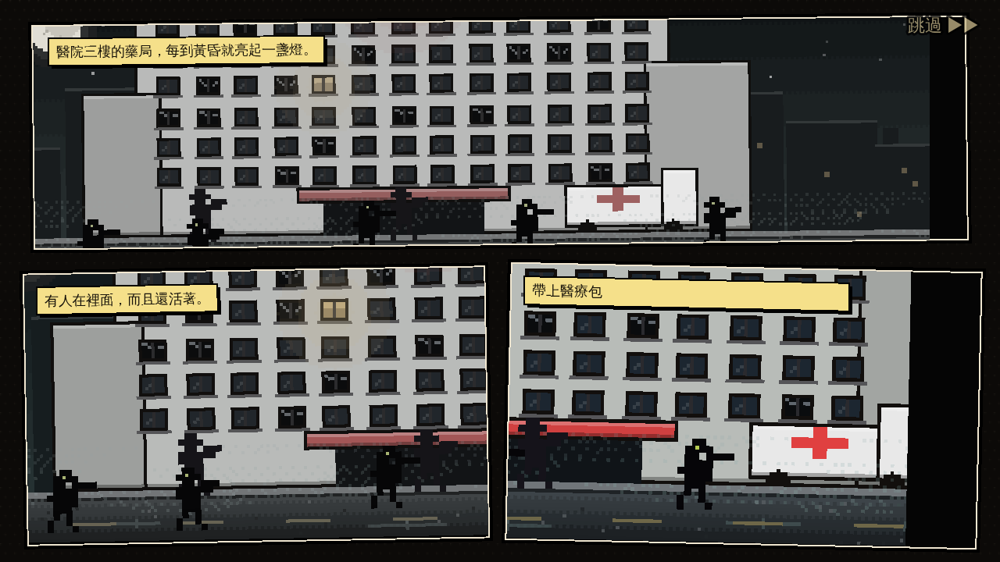

# 漫畫分格敘事演出（Sequential Comic Panel Cinematic）

遊戲的**統一敘事風格**：劇情導入、故事過場、角色介紹、重要事件（含探索事件的 QTE）全部用同一套演出引擎。
參考《Ultimate Spider-Man》（2005）的動態漫畫過場：畫格在同一個畫面裡一格一格累積，而不是翻頁或幻燈片。

> 核心原則：**過去的畫面成為背景，現在的畫面成為焦點，新畫格的出現代表劇情時間的推進。**

## 看起來是這樣

| | |
|---|---|
|  |  |
| 1–2 建立場景 → 角色發現異常（舊格開始變暗） | 3 異常發生：外框先出現，畫面由上往下揭開 |
|  |  |
| 4 角色採取行動（放大彈出、水平速度線） | 5 重大事件：大格突破版面砸進來，霧屍的手伸出格子 |
|  |  |
| 定格：白閃、褪色、網點 | 6 收束：大格退回版面一角，整頁就是事件的前因後果，接上正式遊戲 |

探索 QTE 也用同一套（見 [EXPLORATION.md](EXPLORATION.md)）：上排交代狀況 → 動作格裡進行 QTE → 結果格依評等換圖。

## 規則（引擎自動處理）

- **逐格進場**：一次只進一格，有節奏；進場方式有滑入（四方向）、放大浮現、展開（unfold）、裁切揭露（wipe）、砸入（slam）、直接切入。
- **舊格保留、退到背景**：每進一格，舊格依「出現先後」逐層壓暗、褪色、微縮；最新的格子明亮、高對比，是焦點。
- **重大事件突破版面**：`slam` 讓大格蓋過其他格子，白閃＋鏡頭震動＋手把震動；`pop` 讓角色的手、武器伸出格子邊界（畫在遮罩外）。
- **格內運鏡**：每格可以設定推近、拉遠、平移（`cam.from → cam.to`），畫格本身也能傾斜（`tilt`）做出非對稱版面。
- **漫畫文字**：旁白框（黃底方框）、對白泡泡（白底圓角＋尾巴）、心聲（小圓點尾巴）、大喊（鋸齒框），打字機效果逐字出現；擬聲字大字斜放、描黑邊、砸下來。
- **速度線**：焦點格的放射速度線／水平速度線每 70ms 重畫，線條會閃動；格子退到背景後就停。
- **定格（freeze）**：白閃、焦點格的運鏡停住、褪色、蓋上網點，再接下一格。
- **重新排版（move）**：把大格縮回版面一角，讓所有格子形成完整的事件脈絡。
- **操作**：點一下（或空白鍵、Enter）＝動畫快轉到定位；已經定位就往下一格。劇情演出右上角有「跳過」。
- **互動（interact）**：把控制權交給宿主場景（例如 QTE），宿主回傳結果字串，`branch` 依結果接不同的格子。

## 檔案

| 檔案 | 內容 |
|---|---|
| `src/comic/types.ts` | 劇本格式（Beat、PanelBeat…），每個欄位都有註解 |
| `src/comic/ComicSequencer.ts` | 演出引擎：任何場景都能 `new ComicSequencer(scene, script, opts).run()` |
| `src/comic/art.ts` | 插圖 id → 貼圖：`qte/<事件>/<格>` 走 ComicArt，其他走 CinemaArt；**已預載的同名貼圖優先** |
| `src/scenes/ComicScene.ts` | 通用的劇情演出場景：`scene.launch('Comic', { script: 'prologue_intro', onDone })` |
| `src/data/cinematics.ts` | 手寫分鏡的劇情劇本（目前：序章開場 `prologue_intro`） |
| `src/comic/storyComic.ts` | 文字劇情自動排成一頁漫畫：主角序章、章節開場、序章收尾 |
| `src/art/CinemaArt.ts` | 劇情插圖（目前是程式畫的占位圖） |
| `src/scenes/QteScene.ts` | 探索 QTE 的漫畫模式（依 `src/data/comics.ts` 組出劇本） |

## 寫一段新演出

```ts
// src/data/cinematics.ts
my_scene: {
  id: 'my_scene',
  skippable: true,
  beats: [
    { type: 'panel', id: 'a', art: 'my_wide', rect: { x: 14, y: 12, w: 400, h: 150 }, tilt: -1, enter: 'slide-left',
      cam: { from: { zoom: 1, x: 0.2 }, to: { zoom: 1.1, x: 0.7 } },
      texts: [{ text: '旁白', x: 10, y: 8 }] },
    { type: 'panel', id: 'b', art: 'my_face', rect: { x: 428, y: 18, w: 198, h: 180 }, enter: 'slide-right',
      texts: [{ text: '對白', kind: 'speech', x: 100, y: 130, tail: [90, 120] }] },
    { type: 'panel', id: 'c', art: 'my_boom', rect: { x: 150, y: 40, w: 470, h: 300 }, enter: 'slam', fx: ['speed'],
      sfx: [{ text: '轟！', x: 300, y: 70, size: 30 }], pop: { art: 'my_hand', x: 20, y: 230, from: [60, 0] } },
    { type: 'freeze' },
    { type: 'title', text: '第二章', sub: '副標', hold: 'tap' },
  ],
  endTap: false,
},
```

播放：`this.scene.launch('Comic', { script: 'my_scene', onDone: () => ... })`。

### 版面建議（640×360）

- 不要固定網格：格子大小、位置、角度跟著劇情張力走；格子之間留 10～16px 的黑色間隔。
- 視線順序：先左上、再右上、再下排；重大事件可以蓋過其他格子。
- 一格只講一個瞬間：建立場景 → 發現異常 → 異常發生 → 採取行動 → 重大事件 → 收束。
- 停留時間沒填會依文字量自動決定（1.1～4.2 秒）；一定要玩家讀完的格子用 `hold: 'tap'`。

### 互動演出（QTE）

```ts
const seq = new ComicSequencer(this, script, {
  interact: (id, rect) => new Promise((resolve) => { /* 在 rect 裡放 QTE，結束時 resolve('great' | 'ok' | 'fail') */ }),
});
await seq.run();
```

劇本裡放 `{ type: 'interact', id: 'qte', panel: 'act' }`，後面接 `{ type: 'branch', cases: { great: [...], ok: [...], fail: [...] } }`。
宿主場景的 QTE 元件深度要 ≥ 100（引擎自己的 UI 都在 100 以下）。

## 插圖（換成生成圖）

演出系統和插圖是分開的：現在的圖都是預留的占位，等全部美術重整、統一風格後直接替換，劇本、版面、演出效果都不用改。

- 現在所有劇情插圖都是 `src/art/CinemaArt.ts` 程式畫的占位圖，用來定構圖、明暗、焦點位置。
- 插圖會依畫格大小放大到剛好蓋滿（接近整數倍時吸到整數倍），運鏡在插圖範圍內移動，所以構圖四周要留一點邊。
- 換成本地 H3 模型生成的像素插圖：把 PNG 放進 `public/`，在 BootScene 以**同一個 id 當貼圖 key** 預載（例如 `pro_roof`），
  `src/comic/art.ts` 會優先用已存在的貼圖，占位圖自動退場，劇本不用改。
- 突破格子的物件（`pop`）用透明底。

## 自動排版的劇情頁（storyComic）

主角序章、章節開場、序章收尾、探索完成一章時的收尾原本是文字劇情卡，現在全部用 `storyComic()` 自動排成一頁漫畫，舊的劇情卡（StoryScene）已移除：

1. 上排大全景：該區的關卡插圖，鏡頭從左搖到右，旁白是第一句。
2. 主角登場格（主角序章、序章收尾）：放大裁切壓暗的背景＋速度線，主角從格子底部衝出來，打上名字與身分。
3. 下排每句一格：同一張插圖不同位置放大裁切，傾斜角度、進場方式輪替；超過的句子併進最後一格。
4. 標題卡：章名＋目標（章節收尾則列出開放的新區域、新武器、下一章），點一下繼續。

| | |
|---|---|
|  |  |
| 主角序章（含登場格） | 章節開場 |

重要段落要更有張力時，改到 `src/data/cinematics.ts` 手寫分鏡（序章開場就是這樣做的）。

## 之後

- 各章重要段落改成手寫分鏡（專屬插圖、砸入、定格）。
- 開鎖、電箱接線、圍困救援等事件演出的開頭／結尾接上漫畫格。
- 插圖換成生成圖（見上一節）。
