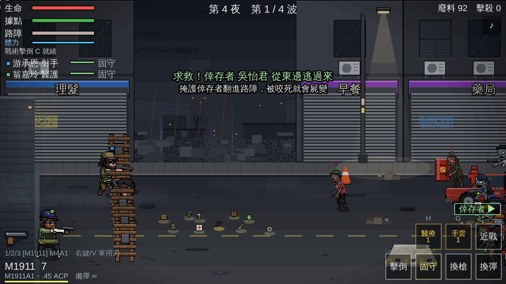
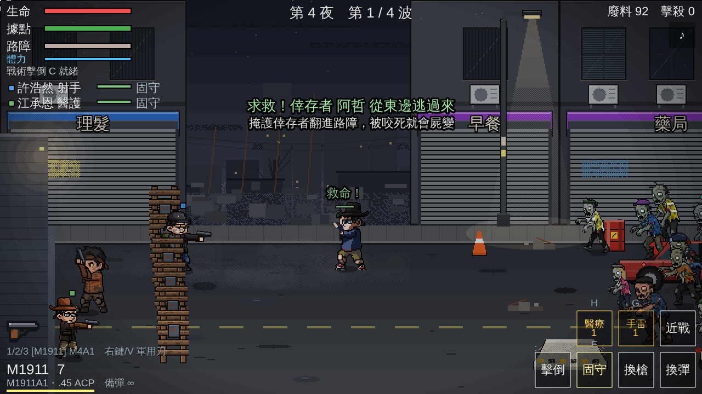
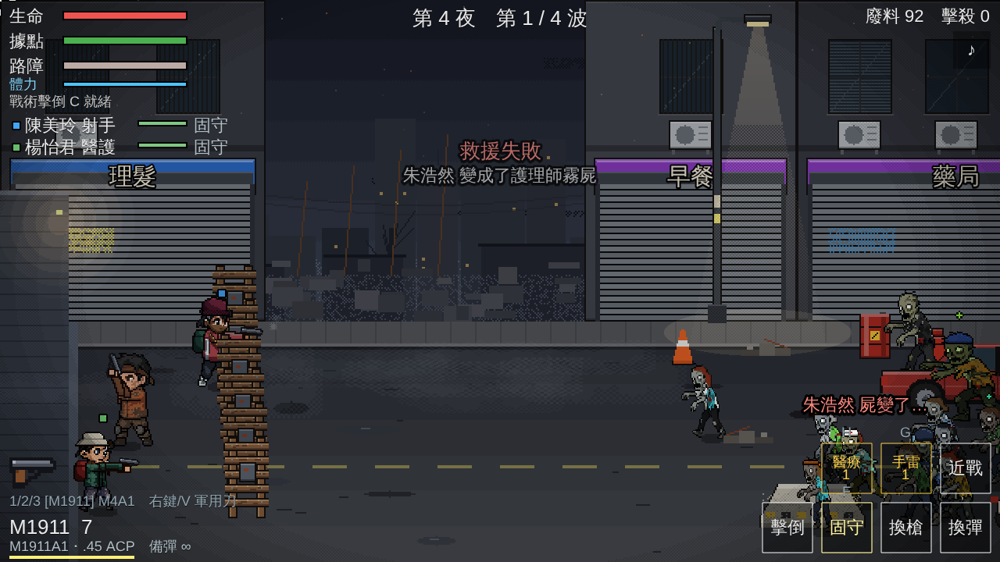
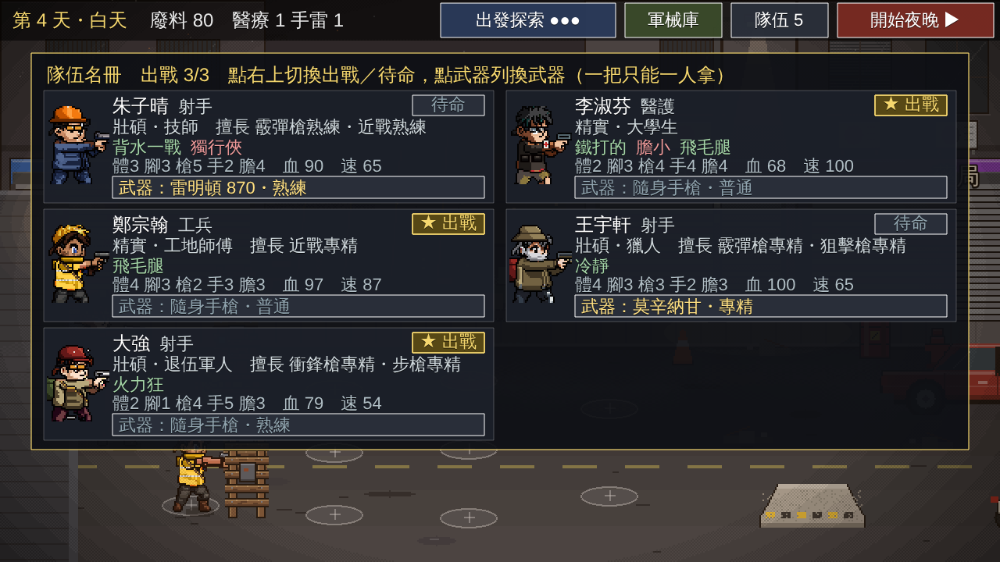

# 夜晚防守：職業掉落與拯救倖存者

## 職業霧屍掉落

特殊職業霧屍倒下時（不論是誰打死的），有機率在屍體旁掉出生前的裝備。
掉落物留在地上 16 秒（最後 4 秒閃爍），主角走到旁邊就會吸過來；想撿就得翻出路障冒險。
撐過一夜時，地上還沒撿的東西會自動收回據點。

| 職業 | 機率 | 可能掉落 |
| --- | --- | --- |
| 警察 | 45% | 9mm 彈、.357 彈、霰彈、鎮暴盾牌（路障 +30）；稀有：.357 左輪、雷明頓 870 |
| 士兵 | 60% | 5.56 彈、7.62 彈、醫療包；稀有：M4A1、AK-47 |
| 護理師 | 50% | 繃帶（生命 +25）、醫療包 |
| 工地 | 45% | 木板鐵釘（路障 +40）、廢料；稀有：大鐵鎚 |
| 消防員 | 45% | 破門工具（路障 +55）、氧氣面罩（生命 +20）、醫療包；稀有：消防斧 |
| 囚犯 | 40% | 開鎖工具、廢料、噪音誘餌；稀有：開山刀 |
| 慢跑者 | 20% | 運動飲料（生命 +15）、廢料 |

- 每種變異額外 +12% 機率；平民、腫脹霧屍、動物不掉
- 武器只掉還沒擁有的，掉落時會跳「掉了一把武器！」，撿到後放進軍械庫（下一夜可以帶）
- 數值：`src/data/drops.ts`；邏輯：`src/systems/ZombieDrops.ts`

## 拯救倖存者（隨機事件）

第 2 夜起，每夜 60% 機率在入夜 16–40 秒時發生：倖存者從戰場東緣往據點跑，後面追著一小群霧屍
（2 隻起，每兩天多 1 隻，最多 6 隻）。霧屍會優先撲向倖存者，倖存者被擋住會放慢、往上下閃。
倖存者在鏡頭外時，畫面邊緣會有「倖存者 ▶」提示。

- **翻進路障** → 加入隊伍（隨機長相、出身、特質，和白天救回的一樣）。出戰人數沒滿就當晚直接參戰
- **被咬死** → 倒地抽搐 1.4 秒後屍變，依出身變成對應的職業霧屍（前警察 → 警察霧屍、退伍軍人 → 士兵霧屍、
  醫師／護理師 → 護理師霧屍、工地師傅／技師 → 工地霧屍、運動員 → 慢跑者、幫派／格鬥教練 → 囚犯霧屍）
- 事件進行中，這一夜不會結束；隊伍已有 8 人就不再發生
- 數值：`src/data/rescue.ts`；邏輯：`src/systems/RescueEvent.ts`
- 測試：開發模式網址加 `?rescue`，入夜 3 秒後一定觸發

## 出戰隊員與武器配發

- 白天「隊伍」名冊每張卡右上角可切換 **★ 出戰／待命**，最多 3 人出戰；負傷的不能上場
- 新加入的隊員在名額滿時先待命；名冊的出戰數就是當晚實際上場的人（夜晚強度也依這個人數縮放）
- 一把武器同時只在一個人手上，而且**不會再被搶走**：隊員換武器只會輪到沒人拿的；
  主角帶著的要先到軍械庫卸下，隊員拿著的要先在名冊收回，軍械庫也不能直接把隊員手上的槍帶上場

