# 白天探索

白天除了布置據點，還可以出門搜刮。探索是彈藥、武器、倖存者和輔助用品的主要來源，
固定的「白天搜刮」收入因此降到 10 廢料（附近零星撿拾）。

## 一天的流程

1. 白天上方列有「出發探索 ●●●」，每天 **3 個時段**。
2. 城市地圖選區域：近區花 1 時段、遠區 2 時段；每區一天只能去一次。新區域由主線章節開放（見 [PROGRESSION.md](PROGRESSION.md)）。
3. 挑最多 **2 名同行隊員**（負傷休養中的不能選）。
4. 路線上有 3～4 站，每站抽一個隨機事件；最後一站是大獎。每站之間可以「沿街前進」（單軸橫向捲軸）或「抄近路」，也可以用醫療包、或撤退回家。
5. 回到據點後背包入帳：彈藥與用品有上限，放不下或重複的武器換成廢料，倖存者直接加入隊伍。
6. **沒用完的時段**在入夜時換成「留守整備」：每個時段修路障 15% 上限＋4 廢料。建造本身不花時間。

## 事件插圖

每張事件卡最上方都有一格像素分鏡（284×86），把事件寫到的東西直接畫出來：上鎖的鐵櫃、塌掉的樓板下發光的眼睛、
公車頂上揮手的人、營火旁舉手的拾荒者、整排槍械櫃與警察霧屍……同一個事件在不同區域會換上那一區的牆色、地板與天色。
抵達區域時顯示該區的章節插圖。選項按鈕左邊有小圖示（時機條、方向鍵、連打、潛入、戰鬥、保護、撐時間、檢定、消耗用品），
結果與帶回家的清單也都換成「圖示＋數量」，不再只是一行行文字。

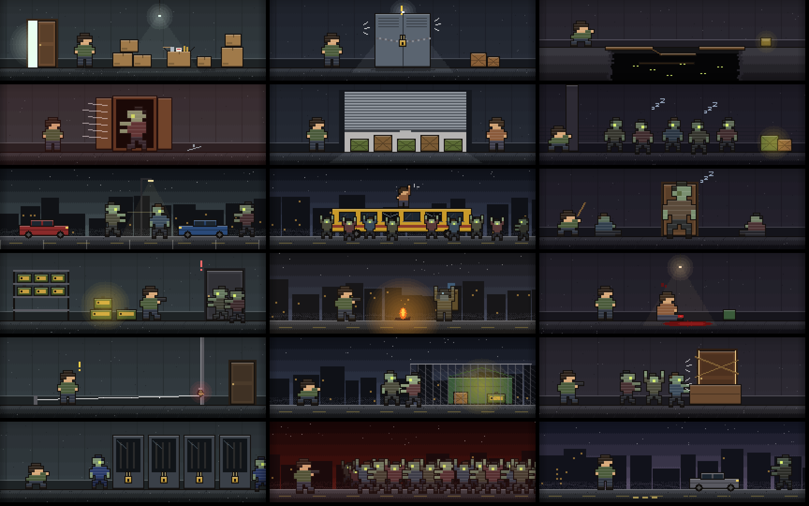

程式在 `src/art/EventArt.ts`：新增事件時在 `PAINTERS` 加一個畫圖函式（沒加的會先用儲物間的圖）。

## 事件演出：漫畫格 QTE、開鎖、圍困救援

### 漫畫格 QTE（6 個招牌事件）

腐朽的樓板、櫃子裡衝出來的霧屍、卡住的鐵捲門、可疑的絆線、樓梯間的跑者（新）、野狗（新）不再跳出單純的 QTE 面板，
而是像美式漫畫一樣一格一格滑進來：

1. 第 1、2 格交代狀況（旁白框＋狀聲詞），點一下可以跳過等待。
2. 第 3 格是動作格：第 2 格放大、壓暗，QTE 就在這格裡進行。
3. 第 4 格依結果換成不同的結果圖：**大成功**（時機條沒失誤、方向鍵／連打剩一半左右的時間）、**成功**、**失敗**，蓋上評等章，點一下繼續。

大成功有自己的獎勵（`great`，例如樓板多一個背包、絆線拆出兩倍零件），沒填就跟成功一樣。

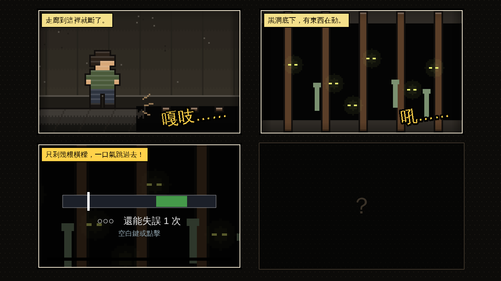
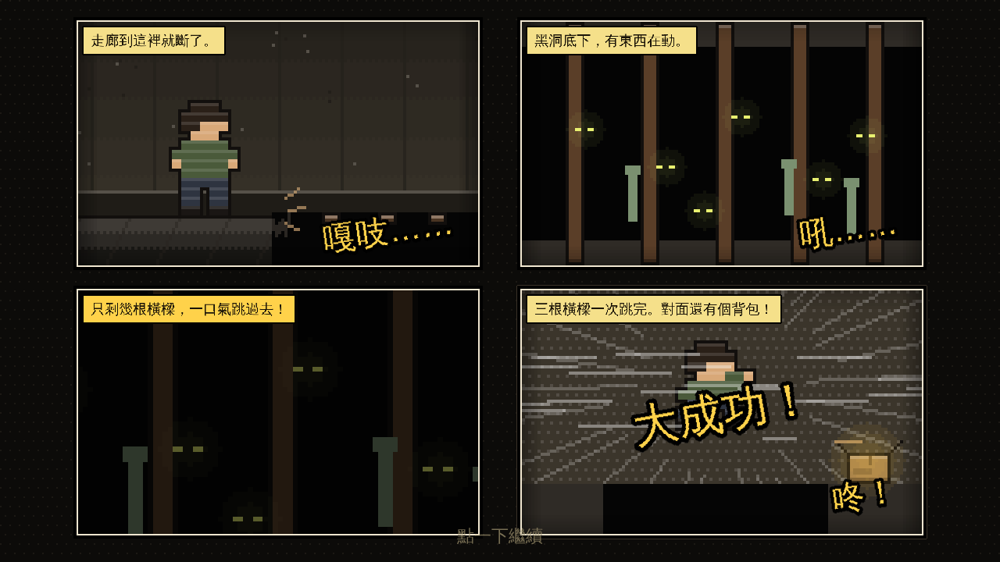
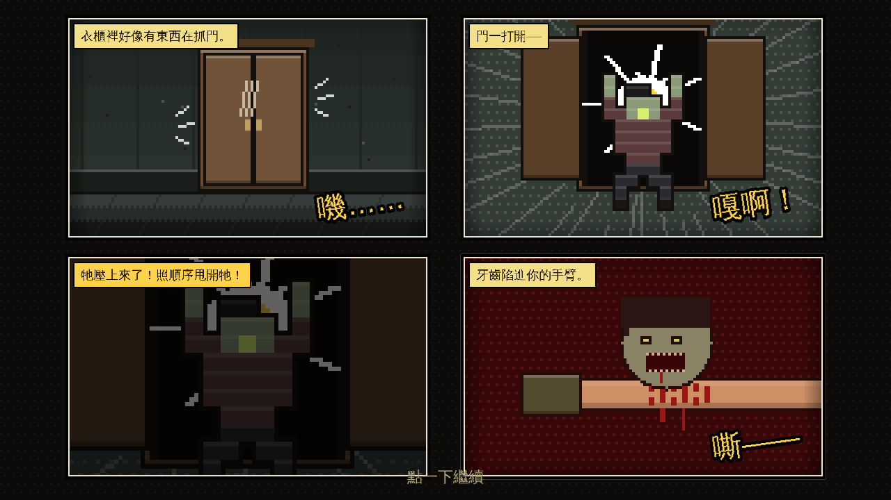

- 分鏡內容（旁白、狀聲詞）：`src/data/comics.ts`。
- 分鏡圖（每格 128×78，畫面上放大 2 倍，跟著區域換配色）：`src/art/ComicArt.ts`，每個事件五格 `s1`、`s2`、`great`、`ok`、`fail`。
- 新增招牌事件：comics.ts 加一筆、ComicArt 的 `PANELS` 加五個畫圖函式，事件的 qte 動作填 `comic: '<id>'`。

### 開鎖小遊戲（`LockScene`）

三種輪替，事件用 `{ type: 'lock', lock: { kinds, tier, prompt } }`，`kinds` 給幾種就進場時隨機抽一種：

| 玩法 | 怎麼玩 | 難度（tier 1～3） |
|---|---|---|
| 彈子鎖 | 彈子上下跳，跑到金線時按下卡住，一根一根推完；推歪了上一根也會掉回去 | 3～5 根、跳得更快 |
| 密碼轉盤 | 線索藏在房間裡（月曆、相框、便利貼、牆上的刮痕…），點開找到每一位數字，再轉開；試錯會告訴你「對了幾位」 | 3～4 位 |
| 電箱接線 | 旋轉接頭，把電從左邊的電池接到右邊的鎖 | 4×3～6×4 格 |

- 失誤 3 次或時間到就失敗，每次失誤噪音 +4。隊伍膽識越高時間越多、判定越寬。
- **開鎖工具**：事件上的「用開鎖工具」仍然直接打開；小遊戲裡也能花一個「輔助」：彈子判定變寬、變慢；轉盤直接聽出一位數字；接線前半段自動接好。
- 使用的事件：上鎖的鐵櫃（彈子鎖／轉盤）、辦公室的保險箱（新，轉盤）、斷電的倉庫門（新，接線）、上鎖的槍械櫃（三種都可能，最難）。

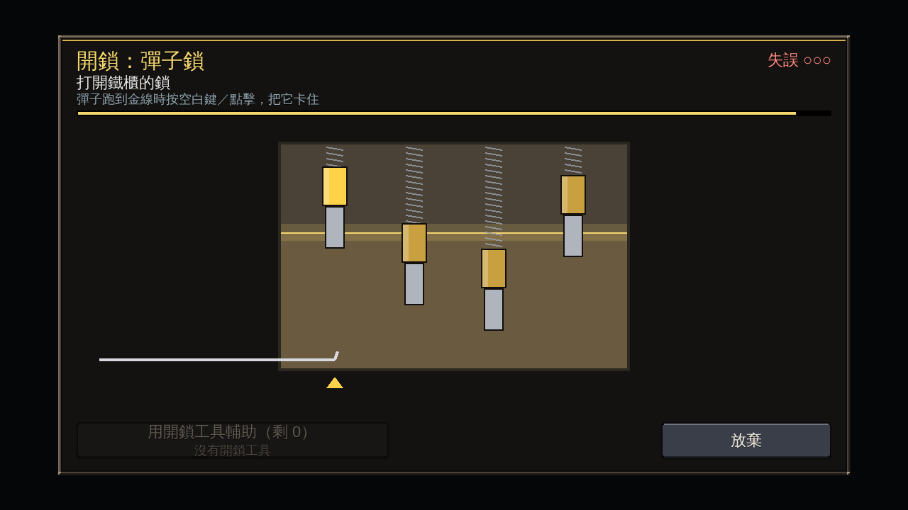
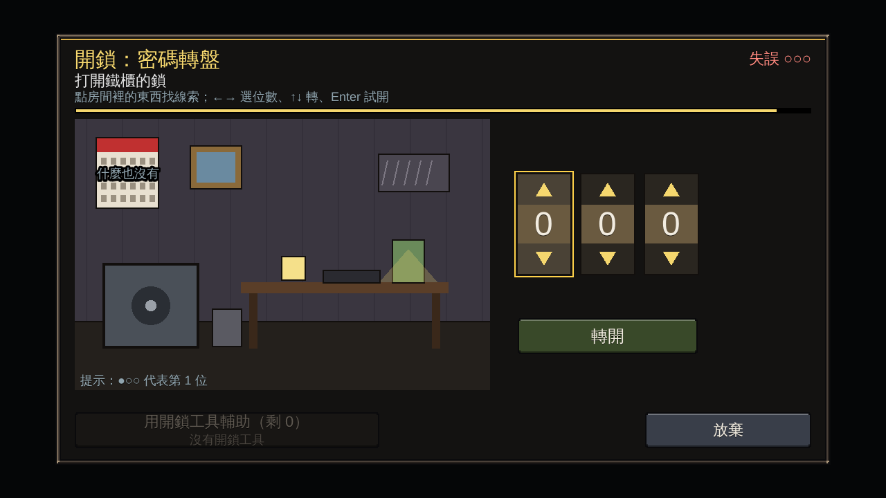
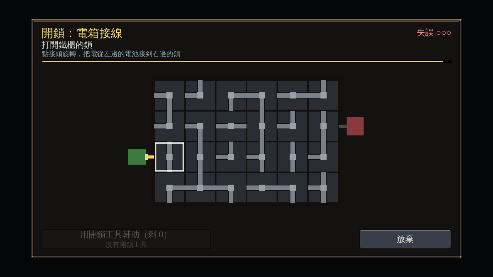

### 圍困救援（`SiegeScene`）

不是守據點也不是清場：場景很小、四面八方都是霧屍，目標是**撐到進度條跑滿**，中間不能讓倖存者被咬死。
主角只能左右跑，到破口旁邊揮棒（空白鍵／點自己旁邊；點破口會跑過去再揮）。站在破口旁邊會頂住，霧屍爬得慢很多。

| 版面 | 事件 | 目標 | 破口 |
|---|---|---|---|
| 公車頂 | 被包圍的倖存者 | 撐 40 秒到引擎發動 | 4 處爬上車頂（爬上來就撲主角）＋擋風玻璃、車門（被敲破就直接咬司機） |
| 便利店 | 倖存者的避難所（大獎） | 撐 45 秒到後門撬開 | 玻璃門、兩扇後窗、右側落地窗、天花板通風口；破了霧屍衝向倖存者，要追上去打兩下 |

急迫感：破口從 2 個越開越多、爬得越來越快；鏡頭慢慢拉近；破口要破時頭上冒紅色「！」；倖存者會喊叫；
自己或倖存者血少時畫面四周發紅、心跳；最後五秒大字倒數。勝利時公車輾開屍群衝出去／一家人從後門逃走。
結果：成功、失敗（倖存者死了，自己逃走受點傷）、倒下（跟一般探索倒下一樣）。

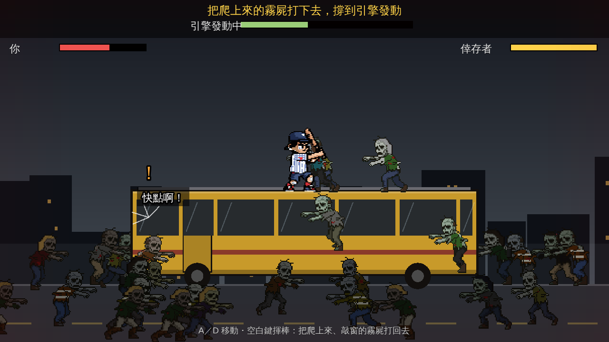
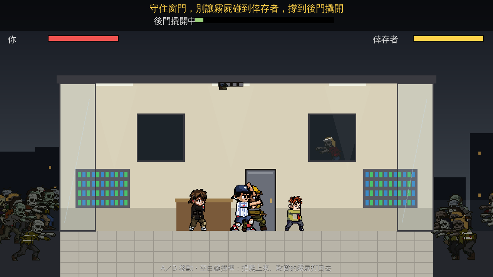

事件用 `{ type: 'siege', siege: { layout: 'bus' | 'store', seconds, title } }`；版面、破口位置與喊叫台詞在 `SiegeScene.ts` 的 `LAYOUTS`。

## 單軸空間（橫向捲軸）

除了 2.5D 的戰場，探索多了一種**只能左右移動**的單軸模式（`FieldSpec.axis = 'single'`）：所有人的腳底都壓在同一條線上，
瞄準高度鎖在身體高度（手機點哪裡都打得到前方），擋路的道具自動挪到後排。

- **沿街前進**：每站之間的預設走法。進入橫向捲軸的街道（1600 寬），霧屍零星站在前方，走近 380px 內才撲過來；
  路邊有可以打開的箱子、車子。走到右邊閃著「！」的路牌才翻開這一站的事件卡。噪音越大，背後還會跟上來幾隻。
- **抄近路**：不走街道，直接看事件卡（舊的玩法，比較快但拿不到路上的東西）。
- **單軸事件**：「睡在門口的大傢伙」的近戰選項（霧屍排成一列，只能近戰）、「屍潮來襲」（前後夾擊撐 25 秒）也是單軸。

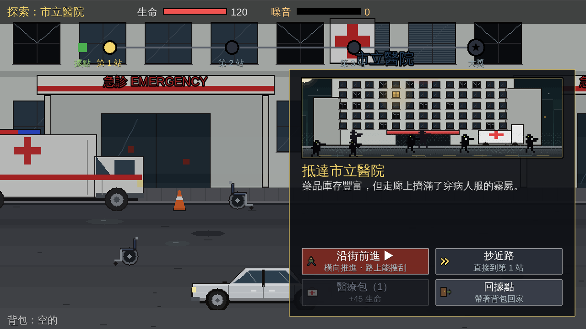

數值在 `src/data/explore.ts` 的 `WALK`；單軸開關是 `src/config.ts` 的 `setSingleLane()`（場景結束自動還原，夜晚防守不受影響）。

## 區域

| 區域 | 距離 | 風險 | 開放 | 主要掉落 | 倖存者 |
|---|---|---|---|---|---|
| 廢棄加油站 | 近 | ★ | 開局 | 廢料、9mm、誘餌 | 工兵 |
| 社區超市 | 近 | ★★ | 第一章完成 | 醫療包、霰彈 | 各職業 |
| 住宅區 | 近 | ★★ | 第一章完成 | 倖存者、近戰武器、.357 | 各職業 |
| 市立醫院 | 遠 | ★★★ | 第三章完成 | 大量醫療包、MP5 | 醫護 |
| 警察局 | 遠 | ★★★★ | 第四章完成 | 槍械、霰彈 | 射手 |
| 軍方檢查站 | 遠 | ★★★★★ | 第五章完成 | 步槍彈、重武器 | 射手、工兵 |

每天會有一則**情報**落在某一區（地圖上的「!」）：求救訊號（大獎必有倖存者）、屍潮經過（風險 +1、戰利品 ×1.5）、
補給空投（大獎多一份）、霧很濃（噪音 −40%）。

## 噪音

開槍、仔細搜刮、QTE 失敗、被發現都會增加噪音。每 25 點噪音，戰鬥多 1 隻霧屍；
滿 100 時下一站強制變成「屍潮來襲」（撐 25 秒，或丟誘餌讓噪音歸零）。

## 事件類型

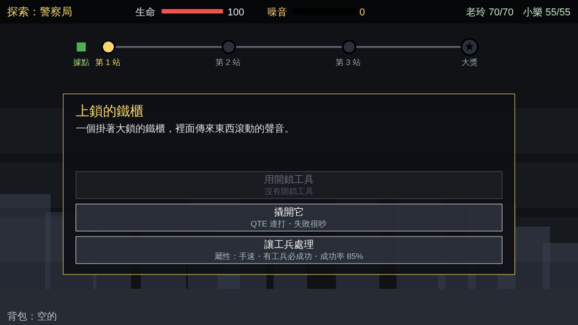

- **搜刮**：快速翻（少、安靜）或仔細搜（多、吵）。
- **QTE**（[QteScene](../src/scenes/QteScene.ts)；招牌事件用漫畫分鏡演出，見上方）
  - 時機條：指針進綠區時按空白鍵／點擊，可失誤 1 次
  - 方向鍵序列：照順序按，限時，按錯即失敗（觸控有方向按鈕）
  - 連打：限時內連按，不按會慢慢掉
  - 隊伍最高「膽識」會放寬時間與判定範圍
- **無聲潛入**（[ExploreFieldScene](../src/scenes/ExploreFieldScene.ts)）：霧屍來回巡邏，地上畫出視野錐；
  被看到會累積警覺「?」，滿了就全員驚醒變成戰鬥。躲在陰影裡比較難被發現，從背後按 E／近戰可以**無聲暗殺**。
  開槍會直接驚動全部。全程沒被發現的獎勵比較好。
- **條件戰鬥**：沿用夜晚的主角、槍械、近戰、霧屍系統。目標有消滅全部、撐過時間、保護倖存者，
  有些事件**禁止開槍**（只能用近戰）。彈藥直接從據點備彈扣。
- **檢定**：依同行隊員的屬性（腳程、手速、膽識）算成功率；有對應職業同行（醫護救傷患、工兵開鎖）直接成功。

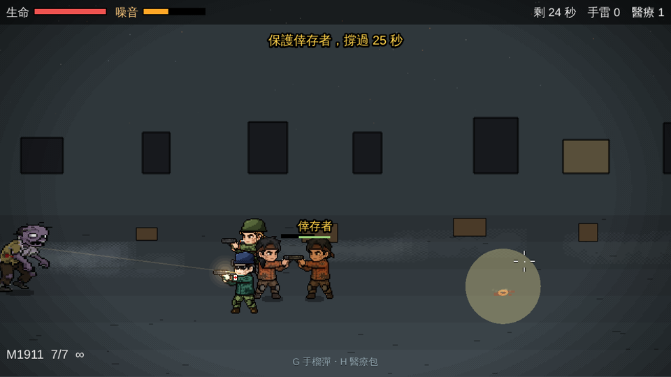

## 同行隊員

- 跟在主角身後，戰鬥中會用職業的槍援護射擊，也會被霧屍攻擊。
- 血量歸零會「倒下」：不會死，回據點後**休養 1 天**（不能出戰也不能探索），名冊上顯示「負傷」。
- 主角倒下時，背包全部丟失，同行隊員都會負傷。
- 腳程影響潛入時被發現的速度（帶越多人越容易被發現），膽識影響 QTE，手速／腳程等用在檢定。

## 輔助用品

| 用品 | 用途 |
|---|---|
| 醫療包 | 探索中兩站之間、探索戰鬥或夜裡（H）回復 45 生命 |
| 開鎖工具 | 直接打開上鎖的櫃子／槍械櫃 |
| 噪音誘餌 | 跳過潛入、引開屍潮（噪音歸零） |

夜裡的觸控 HUD 多了「醫療」按鈕，顯示剩餘數量。（手榴彈已在 2026-11 移除）

## 程式結構

- `src/data/explore.ts`：所有數值與內容（區域、事件、掉落表、情報、用品）。新增事件只要在 `EVENTS` 加一筆。
- `src/explore/Expedition.ts`：一趟探索的狀態與結算（路線、噪音、血量、背包、入帳／失敗）。
- `src/explore/Supplies.ts`：醫療包（夜晚與探索共用）。
- `src/scenes/ExploreMapScene.ts` → `ExpeditionScene.ts` →（`QteScene` / `LockScene` / `SiegeScene` / `ExploreFieldScene`）→ 回到路線圖。
- `GameState`：`supplies`、`dayTime`、`exploredToday`、`intel`，隊員多了 `injuredDays`；舊存檔載入時自動補上。
- `ZombieContext.aggroRange`：探索戰鬥裡霧屍會一路追過來，不必靠近才發現。
