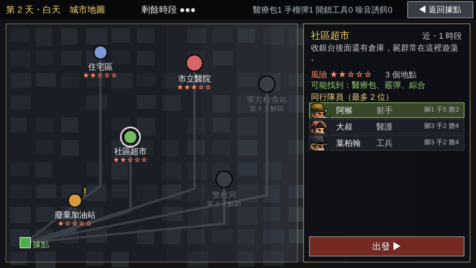
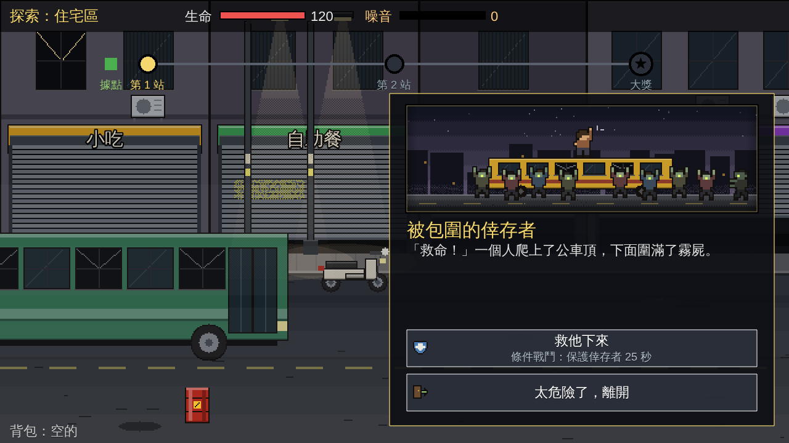
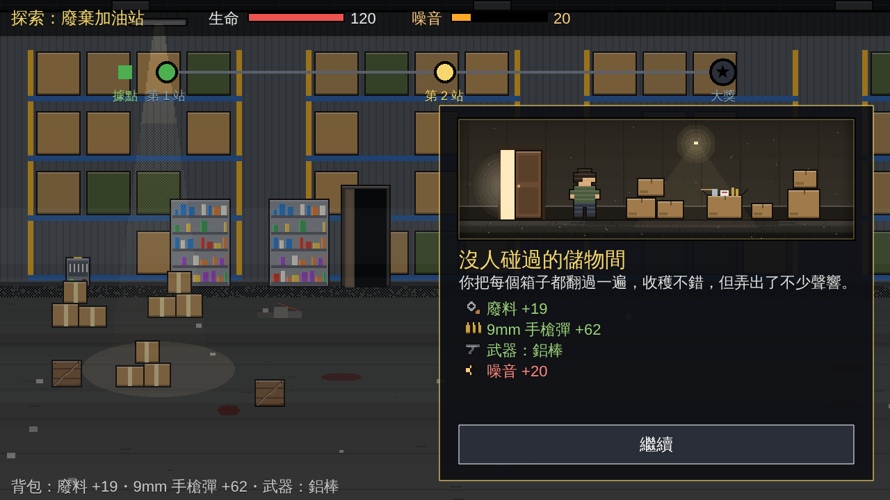
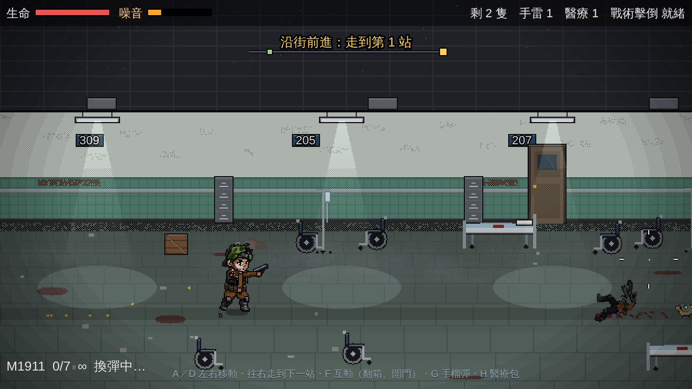
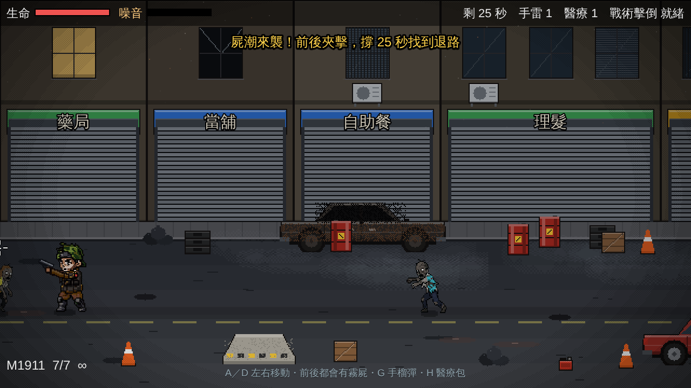
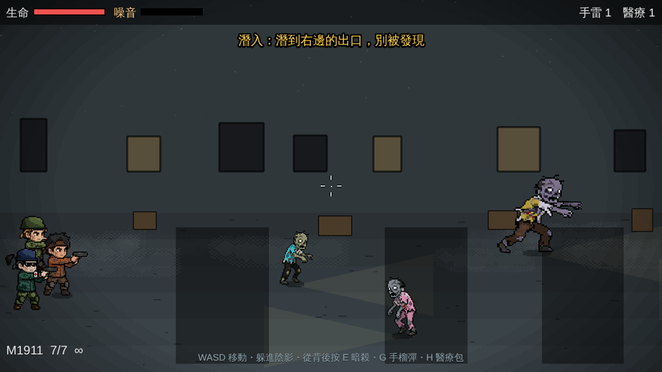

# 白天探索

白天除了布置據點，還可以出門搜刮。探索是彈藥、武器、倖存者和輔助用品的主要來源，
固定的「白天搜刮」收入因此降到 10 廢料（附近零星撿拾）。

## 一天的流程

1. 白天上方列有「出發探索 ●●●」，每天 **3 個時段**。
2. 城市地圖選區域：近區花 1 時段、遠區 2 時段；每區一天只能去一次。新區域由主線章節開放（見 [PROGRESSION.md](PROGRESSION.md)）。
3. 挑最多 **2 名同行隊員**（負傷休養中的不能選）。
4. 路線上有 3～4 站，每站抽一個隨機事件；最後一站是大獎。每站之間可以「沿街前進」（單軸橫向捲軸）或「抄近路」，也可以用醫療包、或撤退回家。
5. 回到據點後背包入帳：彈藥與用品有上限，放不下或重複的武器換成廢料，倖存者直接加入隊伍。
6. **沒用完的時段**在入夜時換成「留守整備」：每個時段修路障 15% 上限＋4 廢料。建造本身不花時間。

## 事件插圖

每張事件卡最上方都有一格像素分鏡（284×86），把事件寫到的東西直接畫出來：上鎖的鐵櫃、塌掉的樓板下發光的眼睛、
公車頂上揮手的人、營火旁舉手的拾荒者、整排槍械櫃與警察霧屍……同一個事件在不同區域會換上那一區的牆色、地板與天色。
抵達區域時顯示該區的章節插圖。選項按鈕左邊有小圖示（時機條、方向鍵、連打、潛入、戰鬥、保護、撐時間、檢定、消耗用品），
結果與帶回家的清單也都換成「圖示＋數量」，不再只是一行行文字。

程式在 `src/art/EventArt.ts`：新增事件時在 `PAINTERS` 加一個畫圖函式（沒加的會先用儲物間的圖）。

## 單軸空間（橫向捲軸）

除了 2.5D 的戰場，探索多了一種**只能左右移動**的單軸模式（`FieldSpec.axis = 'single'`）：所有人的腳底都壓在同一條線上，
瞄準高度鎖在身體高度（手機點哪裡都打得到前方），擋路的道具自動挪到後排。

- **沿街前進**：每站之間的預設走法。進入橫向捲軸的街道（1600 寬），霧屍零星站在前方，走近 380px 內才撲過來；
  路邊有可以打開的箱子、車子。走到右邊閃著「！」的路牌才翻開這一站的事件卡。噪音越大，背後還會跟上來幾隻。
- **抄近路**：不走街道，直接看事件卡（舊的玩法，比較快但拿不到路上的東西）。
- **單軸事件**：「睡在門口的大傢伙」的近戰選項（霧屍排成一列，只能近戰）、「屍潮來襲」（前後夾擊撐 25 秒）也是單軸。

數值在 `src/data/explore.ts` 的 `WALK`；單軸開關是 `src/config.ts` 的 `setSingleLane()`（場景結束自動還原，夜晚防守不受影響）。

## 區域

| 區域 | 距離 | 風險 | 開放 | 主要掉落 | 倖存者 |
|---|---|---|---|---|---|
| 廢棄加油站 | 近 | ★ | 開局 | 廢料、9mm、誘餌 | 工兵 |
| 社區超市 | 近 | ★★ | 第一章完成 | 醫療包、霰彈 | 各職業 |
| 住宅區 | 近 | ★★ | 第一章完成 | 倖存者、近戰武器、.357 | 各職業 |
| 市立醫院 | 遠 | ★★★ | 第三章完成 | 大量醫療包、MP5 | 醫護 |
| 警察局 | 遠 | ★★★★ | 第四章完成 | 槍械、霰彈 | 射手 |
| 軍方檢查站 | 遠 | ★★★★★ | 第五章完成 | 步槍彈、手榴彈、重武器 | 射手、工兵 |

每天會有一則**情報**落在某一區（地圖上的「!」）：求救訊號（大獎必有倖存者）、屍潮經過（風險 +1、戰利品 ×1.5）、
補給空投（大獎多一份）、霧很濃（噪音 −40%）。

## 噪音

開槍、仔細搜刮、QTE 失敗、被發現都會增加噪音。每 25 點噪音，戰鬥多 1 隻霧屍；
滿 100 時下一站強制變成「屍潮來襲」（撐 25 秒，或丟誘餌讓噪音歸零）。

## 事件類型

- **搜刮**：快速翻（少、安靜）或仔細搜（多、吵）。
- **QTE**（[QteScene](../src/scenes/QteScene.ts)）
  - 時機條：指針進綠區時按空白鍵／點擊，可失誤 1 次
  - 方向鍵序列：照順序按，限時，按錯即失敗（觸控有方向按鈕）
  - 連打：限時內連按，不按會慢慢掉
  - 隊伍最高「膽識」會放寬時間與判定範圍
- **無聲潛入**（[ExploreFieldScene](../src/scenes/ExploreFieldScene.ts)）：霧屍來回巡邏，地上畫出視野錐；
  被看到會累積警覺「?」，滿了就全員驚醒變成戰鬥。躲在陰影裡比較難被發現，從背後按 E／近戰可以**無聲暗殺**。
  開槍或丟手榴彈會直接驚動全部。全程沒被發現的獎勵比較好。
- **條件戰鬥**：沿用夜晚的主角、槍械、近戰、霧屍系統。目標有消滅全部、撐過時間、保護倖存者，
  有些事件**禁止開槍**（只能用近戰）。彈藥直接從據點備彈扣。
- **檢定**：依同行隊員的屬性（腳程、手速、膽識）算成功率；有對應職業同行（醫護救傷患、工兵開鎖）直接成功。

## 同行隊員

- 跟在主角身後，戰鬥中會用職業的槍援護射擊，也會被霧屍攻擊。
- 血量歸零會「倒下」：不會死，回據點後**休養 1 天**（不能出戰也不能探索），名冊上顯示「負傷」。
- 主角倒下時，背包全部丟失，同行隊員都會負傷。
- 腳程影響潛入時被發現的速度（帶越多人越容易被發現），膽識影響 QTE，手速／腳程等用在檢定。

## 輔助用品

| 用品 | 用途 |
|---|---|
| 醫療包 | 探索中兩站之間、探索戰鬥或夜裡（H）回復 45 生命 |
| 手榴彈 | 探索戰鬥或夜裡（G）丟向準星，範圍爆炸 |
| 開鎖工具 | 直接打開上鎖的櫃子／槍械櫃 |
| 噪音誘餌 | 跳過潛入、引開屍潮（噪音歸零） |

夜裡的觸控 HUD 多了「手雷」「醫療」兩顆按鈕，顯示剩餘數量。

## 程式結構

- `src/data/explore.ts`：所有數值與內容（區域、事件、掉落表、情報、用品）。新增事件只要在 `EVENTS` 加一筆。
- `src/explore/Expedition.ts`：一趟探索的狀態與結算（路線、噪音、血量、背包、入帳／失敗）。
- `src/explore/Supplies.ts`：手榴彈與醫療包（夜晚與探索共用）。
- `src/scenes/ExploreMapScene.ts` → `ExpeditionScene.ts` →（`QteScene` / `ExploreFieldScene`）→ 回到 `DefenseScene`。
- `GameState`：`supplies`、`dayTime`、`exploredToday`、`intel`，隊員多了 `injuredDays`；舊存檔載入時自動補上。
- `ZombieContext.aggroRange`：探索戰鬥裡霧屍會一路追過來，不必靠近才發現。
