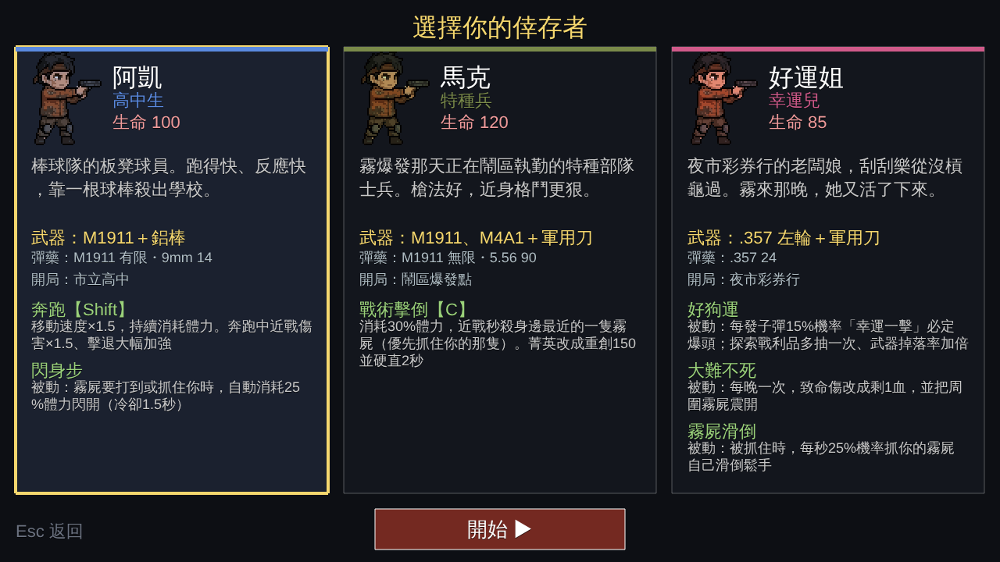
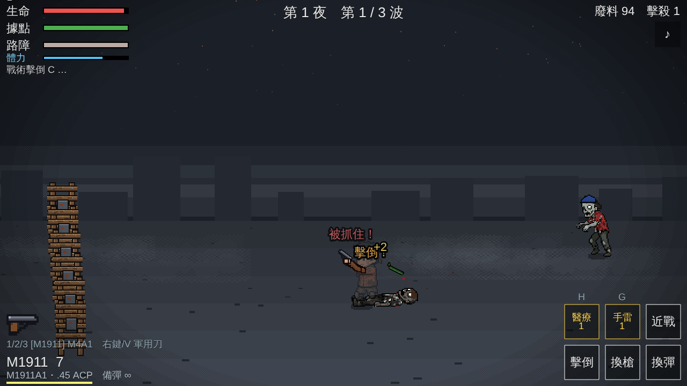
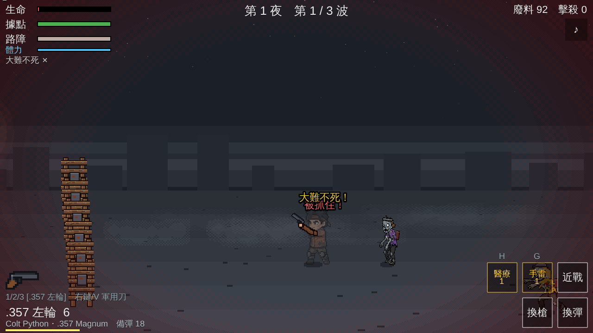

# 三位主角

新遊戲在選角畫面挑一位（←→ 或 1／2／3 選，Enter 開始）。起始武器、生命、開局地點、第一章劇情、技能都不同；
第二章起三人走同一條主線（見 [PROGRESSION.md](PROGRESSION.md)）。

| | 阿凱（高中生） | 馬克（特種兵） | 好運姐（幸運兒） |
|---|---|---|---|
| 生命 | 100 | 120 | 85 |
| 起始武器 | 球棒＋M1911（**有限**，9mm 14 發） | M1911（無限）＋M4A1（5.56 ×90）＋軍用刀 | .357 左輪（24 發）＋軍用刀 |
| 起始用品 | 醫療包 1 | 手榴彈 1 | 醫療包 1、開鎖工具 1 |
| 開局地點 | 市立高中 | 鬧區爆發點 | 夜市彩券行 |

## 技能

**阿凱**
- **奔跑（Shift／觸控「奔跑」切換）**：移動 ×1.5，每秒耗 20 體力。奔跑中揮近戰傷害 ×1.5、擊退 +26、硬直 0.5 秒（跳「衝撞」）。
- **閃身步（被動）**：霧屍要打到或抓住你時，自動耗 25 體力閃開＋0.45 秒無敵（冷卻 1.5 秒）。體力不夠就閃不了。

**馬克**
- **戰術擊倒（C／觸控「擊倒」）**：耗 30 體力，秒殺身邊最近的一隻（優先抓住你的那隻、再來是面向的那邊）。
  菁英（威脅 ≥ 5：壯漢、消防員、士兵、屍熊）改成重創 150＋硬直 2 秒。

**好運姐**
- **好狗運（被動）**：每發子彈 15% 機率「幸運一擊」必定算爆頭；探索戰利品多抽一份彈藥、用品機率 ×1.4、武器掉落 ×2。
- **大難不死（被動）**：每晚（每場探索戰鬥）一次，致命傷改成剩 1 血，2 秒無敵，周圍霧屍被震開、硬直。
- **霧屍滑倒（被動）**：被抓住時，每秒 25% 機率抓你的霧屍自己滑倒鬆手。

## 被霧屍抓住（糾纏）

- 霧屍的攻擊打中主角就會**抓住**不放（屍鴉不會），被抓時不會被打退，畫面上顯示「被抓住」。
- 抓住期間移動 ×0.35，兩隻以上 ×0.2，也不能奔跑。
- 掙脫：殺掉牠、把牠打退超過 36 像素、或讓牠硬直 ≥ 0.2 秒（近戰、制動 ≥ 0.5 的槍、手榴彈、戰術擊倒）。
- 夜晚和探索戰鬥都適用。

## 平衡待定（等確認）

- 阿凱要不要完全沒槍（目前給有限彈的 M1911）
- 被抓住能不能靠近戰／高制動掙脫（目前可以）
- 戰術擊倒要不要也能秒殺菁英（目前不行）

## 程式結構

- `src/data/heroes.ts`：三位主角的資料與所有技能數值（SPRINT、DODGE、TAKEDOWN、LUCK、GRAB）
- `src/systems/HeroSystem.ts`：技能與糾纏邏輯；夜晚（DefenseScene）和探索戰鬥（ExploreFieldScene）共用
- `src/scenes/HeroSelectScene.ts`：選角畫面
- `src/data/story.ts`：`OPENINGS` 各主角的第一章、`PROLOGUES` 各自的序章
- 主角目前共用同一套像素圖（選角卡上用顏色區分），各自的造型之後再補
