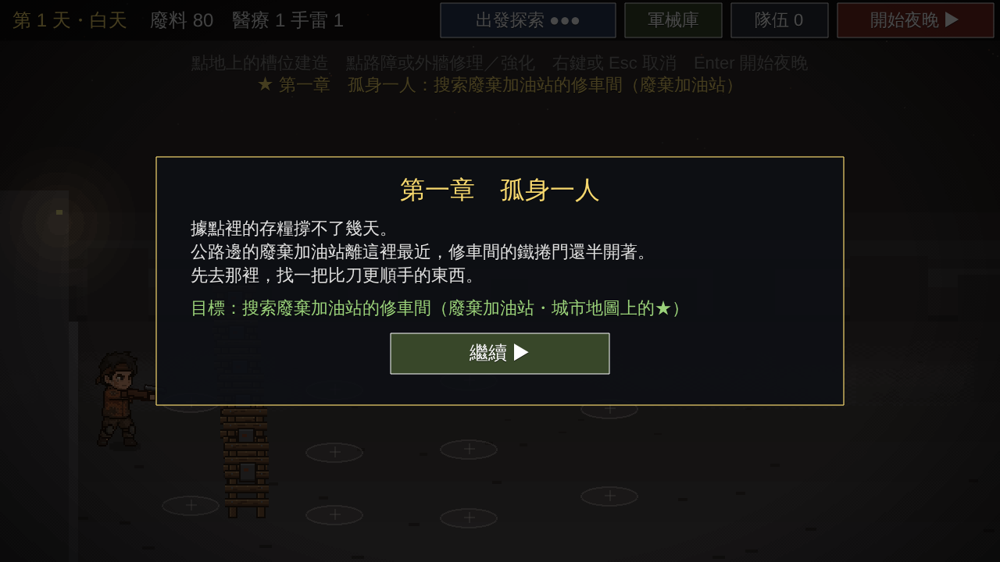
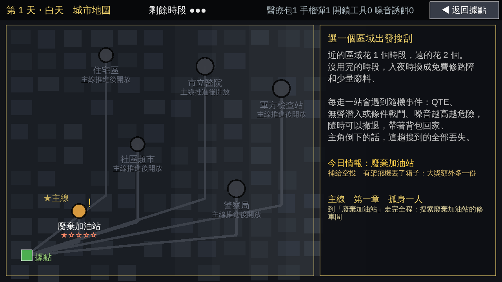
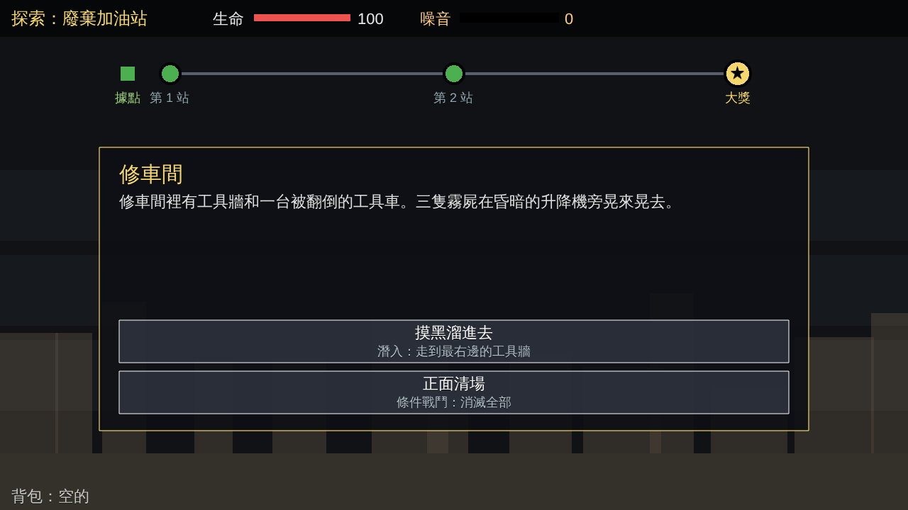
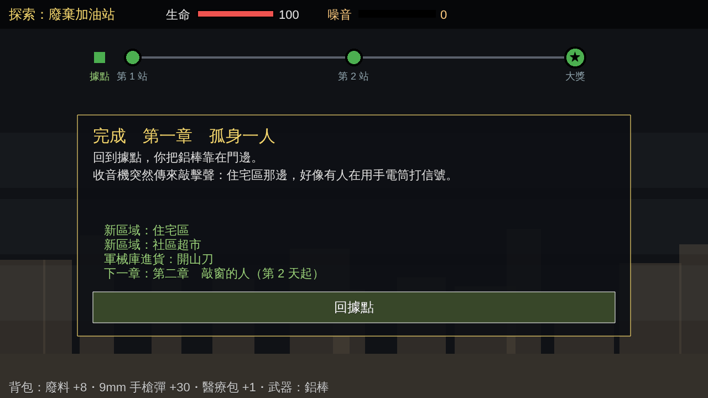
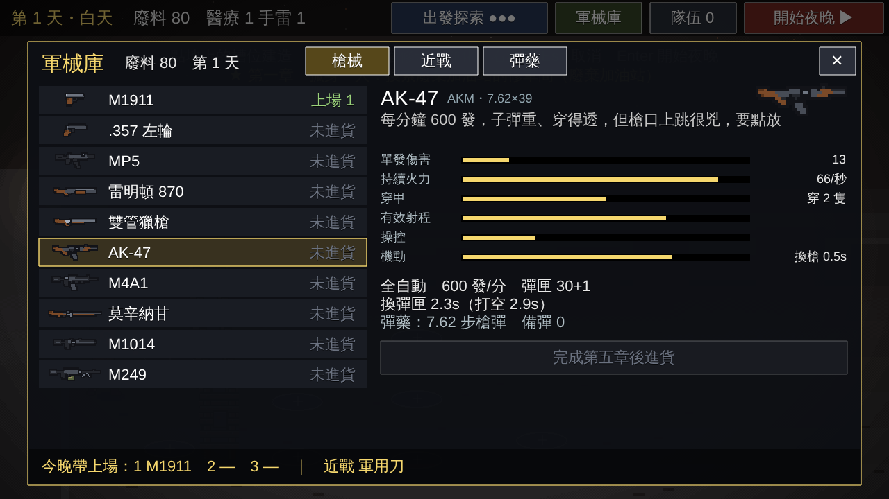
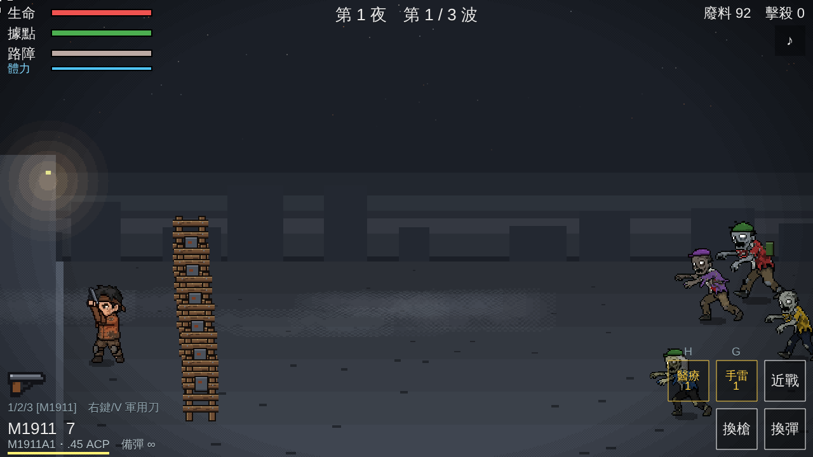

# 開局與主線進程

新遊戲先選主角（阿凱／馬克／好運姐，見 [HEROES.md](HEROES.md)），開局只有**主角一人**、沒有夥伴。
起始武器與開局地點依主角不同；其他夥伴、槍械、新區域都靠**主線六章**一步步拿到，主線之外的時段照常自由探索、建造據點。

## 怎麼推進

1. 新遊戲先播序章，接著播第一章開場（每章開始的那天白天跳出一次）。
2. 白天畫面上方、城市地圖都會標出目前的主線目標；地圖上主線地點有 **★主線**。
3. 到主線區域走完全程，最後一站的大獎會換成**劇情事件**（潛入、條件戰鬥、QTE 或消耗用品）。
4. 劇情事件成功、而且**平安回到據點**，這一章才算完成：拿到固定獎勵、開放新區域、軍械庫進貨。
5. 劇情事件失敗、撤退或倒下都不會完成，隔天可以再去。
6. 每章有「最早第幾天」：一天最多推進一章，節奏不會被一口氣打完。

## 六章內容

| 章 | 最早 | 地點 | 劇情事件 | 固定獎勵 | 開放區域 | 軍械庫進貨 |
|---|---|---|---|---|---|---|
| 一（阿凱）殺出校園 | 第 1 天 | 市立高中 | 體育館：撐 20 秒／潛入 | 醫療包 ×2、噪音誘餌、25 廢料 | 加油站、住宅區、超市＋另外兩個開局地點 | 開山刀 |
| 一（馬克）回到爆發點 | 第 1 天 | 鬧區爆發點 | 軍車：禁止開槍清場／火力壓制 | 5.56 ×60、醫療包、15 廢料 | 同上 | 開山刀 |
| 一（好運姐）頭獎 | 第 1 天 | 夜市彩券行 | 保險箱：方向鍵 QTE／清場 | .357 ×24、開鎖工具、40 廢料 | 同上 | 開山刀 |
| 二　敲窗的人 | 第 2 天 | 住宅區 | 保護倖存者 20 秒／潛入後巷 | **阿哲（射手）**、.357 左輪＋24 發 | — | 雙管獵槍、消防斧 |
| 三　超市倉庫 | 第 3 天 | 社區超市 | 撐開鐵捲門 QTE／守 25 秒 | 雷明頓 870＋30 發、醫療包 ×2 | 市立醫院 | MP5 |
| 四　醫院的燈 | 第 4 天 | 市立醫院 | 守藥局 30 秒／用誘餌 | **林醫師（醫護）**、醫療包 ×3、9mm 60 | 警察局 | 大鐵鎚、M1014 |
| 五　證物室 | 第 5 天 | 警察局 | 開鎖工具／清空走廊 | **老周（工兵）**、M4A1＋90 發、開鎖工具 | 軍方檢查站 | AK-47、M4A1 |
| 六　撤離失敗 | 第 7 天 | 軍方檢查站 | 守指揮車 40 秒／潛入 | M249、步槍彈、醫療包 ×2 | — | 莫辛納甘、M249 |

六章打完播尾聲，之後就是無盡生存：全部區域與武器都開放，夜晚照天數一直變強。

除了三位具名夥伴，探索中的隨機事件（被包圍的倖存者、受傷的倖存者、避難所、拾荒者）照樣能救到隨機夥伴，
所以主線之外多跑探索就能更早湊齊隊伍。

## 軍械庫：劇情解鎖貨架

- 槍和近戰武器不再依天數開賣，而是**完成章節後進貨**；主線的關鍵武器直接在劇情裡撿到。
- 還沒進貨的武器在清單上顯示「未進貨」，詳細頁會說明「第 N 章劇情取得」或「完成第 N 章後進貨」。
- 探索的隨機戰利品也只會掉已經進貨的武器，「第一把步槍」不會在第 2 天就被撿到。

## 單人開局的難度

- **第一夜**改成教學夜：3 波、共 24 隻平民霧屍＋5 隻奔跑者，沒有重型霧屍。
- 第二夜起，夜晚的威脅預算乘上**隊伍倍率**：可出戰隊員 0 人 ×0.6、1 人 ×0.74、2 人 ×0.88、3 人以上 ×1（見 `squadScale`）。
  負傷休養中的隊員不算，所以探索把人弄傷，當晚會比較輕鬆但也少了幫手。
- 起始彈藥依主角（見 HEROES.md）；12 號霰彈一律從 0 開始（拿到雷明頓 870 時附 30 發）。
- 已經擁有的劇情武器（好運姐的左輪、馬克的 M4A1）照一般規則換成廢料。
- 探索倒下時，單人會顯示「自己爬回據點」的文字。

## 程式結構

- `src/data/story.ts`：序章、尾聲、六章的開場／目標／劇情事件／獎勵／解鎖，以及軍械庫的解鎖說明。新增章節只要在 `CHAPTERS` 加一筆。
- `src/state/GameState.ts`：`story` 進度（目前章節、已開放區域、軍械庫貨架、開場播到哪），`completeChapter()`、`pendingIntro()`、`zoneOpen()`、`inShop()`。
  主線之前的舊存檔會當作主線已完成，不會被鎖住。
- `src/explore/Expedition.ts`：主線區域的最後一站換成劇情事件；結果標 `story: true` 時發固定獎勵，`bank()` 時完成章節。
- `src/scenes/StoryScene.ts`：劇情卡（序章、章節開場），由 `DefenseScene.showStoryIntro()` 在白天開場時跳出。
- `src/data/waves.ts`：`NIGHT_ONE` 單人教學夜、`squadScale()` 隊伍倍率。
