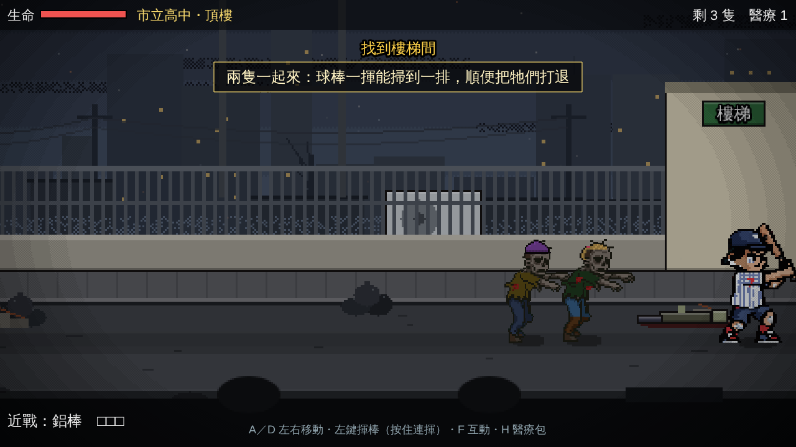
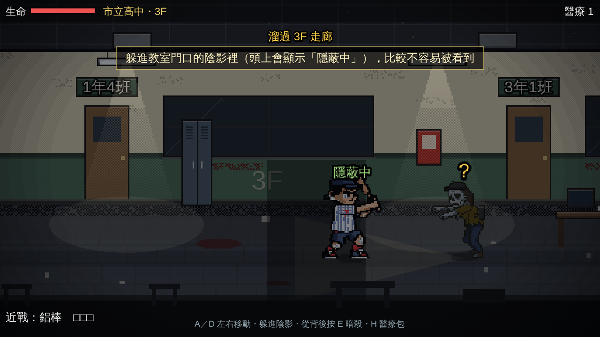
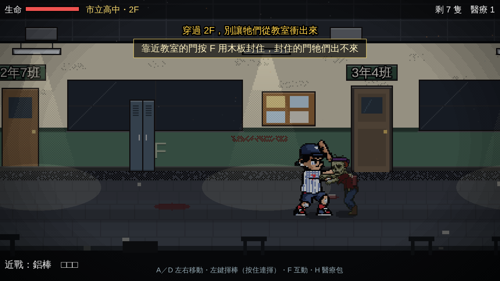
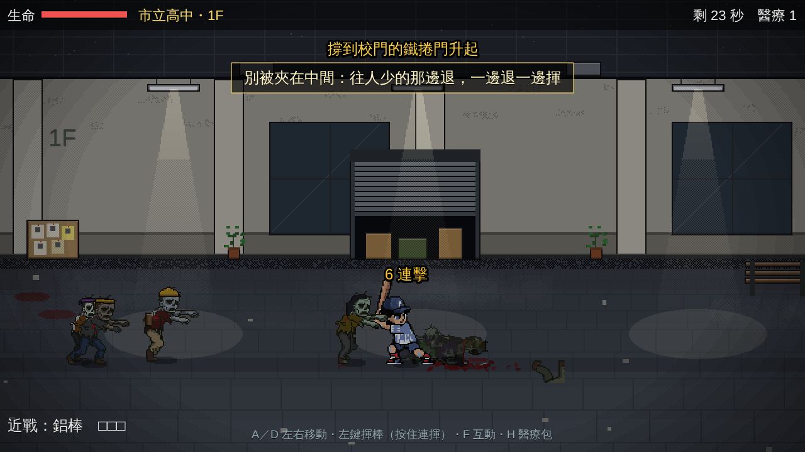
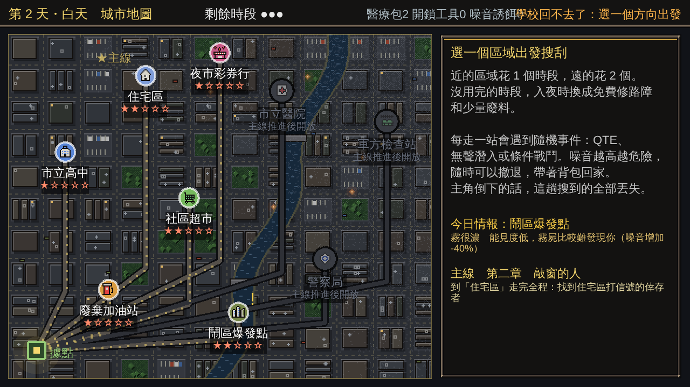

# 序章：放學後（第一夜）

新遊戲不再選據點、選主角，也不打據點前的教學戰。按下開始就是**阿凱**，直接進可以玩的序章。
序章本身就是第一夜：阿凱在學校頂樓睡過頭，醒來發現整間學校都不對勁，一層一層往下逃出校門。

新流程：主選單 → 序章開場卡 → 頂樓 → 4F → 3F → 2F → 1F → 收尾卡 → 第二章開場 → **強制出發探索**（第 2 天白天，城市地圖沒有「返回據點」）。

## 五層樓

全程單軸（只能左右走）、只能近戰（阿凱只有球棒）。單軸模式的鏡頭會拉近 1.5 倍（上下不留大片空白，人和場景放大），HUD 畫在另一個不縮放的鏡頭上；縱深也壓縮：背景整片往下推、後牆貼近走道，前方多一排捲得比較快的近景剪影（室內是課桌椅，室外是欄杆與雜物），和 2.5D 的寬闊場地分得出來。沿街前進等所有單軸關卡都一樣。每層都從滿血開始，倒下就重來那一層，序章不會 Game Over。

| 樓層 | 玩法 | 教什麼 | 過關 |
|---|---|---|---|
| 頂樓 | 戰鬥：1 隻再 2 隻平民霧屍，走近才撲過來 | 移動、揮棒、體力、一揮掃一排 | 走到樓梯間 |
| 4F 走廊 | 戰鬥：3 隻平民＋1 隻跑者 | 自動衝刺撞飛、被抓住怎麼掙脫、閃身步 | 走到樓梯口 |
| 3F 走廊 | **潛行**：4 隻巡邏或站崗的霧屍、4 塊教室門口的陰影 | 躲陰影、看視線光錐、背後 E 暗殺；被發現就變追逐 | 走到樓梯口 |
| 2F 走廊 | 戰鬥：教室的門會被撞開，霧屍陸續冒出來 | F 用木板封門 | 走到樓梯口 |
| 1F 穿堂 | 撐 35 秒，霧屍從兩側一直來 | 前後夾擊時邊退邊打（預告守據點） | 撐到校門的鐵捲門升起 |

一定要**走到樓梯口**才算過關，把整層的霧屍打光不會自動結束。

教學提示是畫面上方的小框，依條件跳出：關卡開始、走到某個位置、第一次打倒霧屍、第一次被抓住、潛行被發現、開打幾秒後。
電腦與手機各有一套文字。

## 逃出校門之後

- 完成阿凱的第一章（開放加油站、住宅區、超市等區域，軍械庫進開山刀），另給醫療包 ×1、廢料 20。
- 第一夜算已經過了：直接變成第 2 天白天，探索時段補滿。
- 播收尾卡，接著播第二章開場，然後進城市地圖。這時地圖上方顯示「學校回不去了：選一個方向出發」，沒有返回鍵。
- 探索回來落腳在**街口據點**（暫時固定；之後換成路線圖與時間條，見下一步）。

## 新增的場景

- **頂樓**（`FacadeStyle 'rooftop'`）：沒有建築立面，看出去是天空和遠方城市；女兒牆＋欄杆、水塔、冷氣主機，最右邊是樓梯間小屋（門對準出口）。地面是水泥樓板。
- **學校走廊**（`InteriorStyle 'classroom'`）：上米白下綠牆裙、每間教室的前門與班級牌、教室窗、公布欄或消防栓箱、地上的血跡。牆上漆著樓層號。
- 五層的擺件在 `src/data/scenery.ts` 的 `EVENT_SETS`（`pro_roof`、`pro_4f`、`pro_3f`、`pro_2f`、`pro_1f`）。

## 程式結構

- `src/data/prologue.ts`：五層樓的內容（霧屍位置與種類、陰影、增援、教學提示、旁白），開場、收尾文字與獎勵。調整序章只改這裡。
- `src/scenes/PrologueScene.ts`：串流程（開場卡 → 樓層轉場 → 打完下一層 → 倒下重來 → 收尾 → 第二章開場 → 強制探索）。
- `src/scenes/ExploreFieldScene.ts`：多了 `stage` 參數。有 stage 時霧屍照設計擺放、走近 `wakeRange` 才醒、增援用指定職業、顯示教學提示、左上顯示樓層、不顯示噪音。
- `src/scenes/MenuScene.ts`：開始遊戲直接 `GameState.reset('student')` 進序章。開發用：網址加 `?floor=N`（1～5）可以直接從第 N 層開始。
- `src/scenes/ExploreMapScene.ts`：`{ forced: true }` 時沒有返回鍵。

## 暫時保留、之後再處理

- 選角畫面（`HeroSelectScene`）和據點前的教學戰（`Tutorial`）還在程式裡，只是新遊戲不會再進去。之後馬克、好運姐改成劇情會合時，選角畫面會改成「會合後選誰上場」。
- 阿凱第一章原本的「體育館」劇情事件由序章取代，不會再觸發。
- 美術：目前用程式畫的走廊和頂樓。漫畫格 QTE 與每層的開場插圖等探索表現那一步再補。

## 截圖

