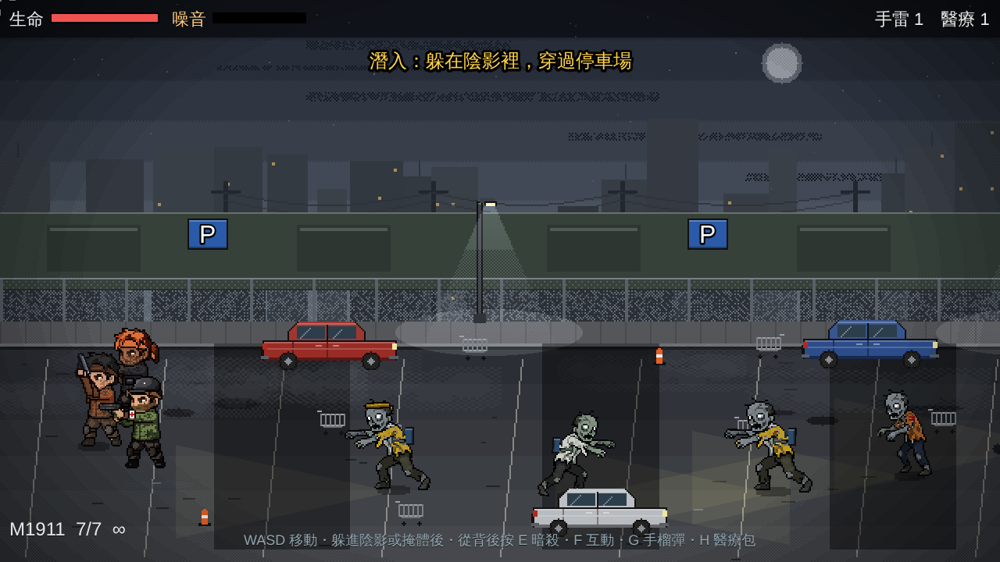
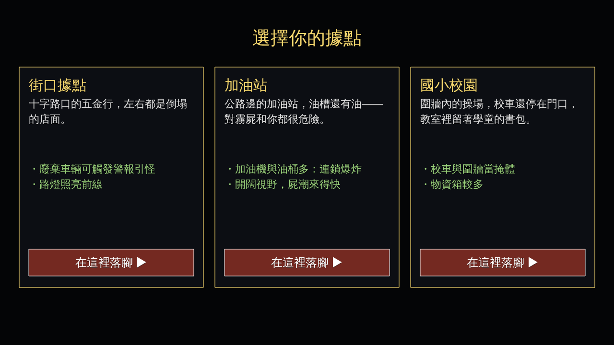

# 場景環境與互動道具

事件文字寫到的地點和東西，畫面上一定看得到：「停車場」有一排車、「公車頂上的倖存者」就站在公車上、
「倉庫裡的補給」有貨架、堆高機和彈藥箱、「上鎖的鐵櫃」事件卡旁邊就是那排鐵櫃。
全部程式畫，沒有外部美術檔。

## 檔案

| 檔案 | 內容 |
|---|---|
| `src/data/scenery.ts` | 地點主題（6 個探索區域＋3 個據點）、事件場景佈置 `EVENT_SETS`、據點地圖 `OUTPOST_MAPS`、道具數值 `PROP_TUNING` |
| `src/art/PropArt.ts` | 約 60 種道具像素圖（車、公車、軍卡、油桶、加油機、貨架、病床、槍械櫃、神明桌…） |
| `src/art/Painter.ts` | 像素畫筆：外框方塊、抖色、漸層、窗戶 |
| `src/scenery/SceneryBuilder.ts` | 畫天空、遠景、中景（視差 0.2／0.5）、主建築立面或室內牆面、地板，擺放道具 |
| `src/scenery/PropSystem.ts` | 互動道具的行為 |
| `src/scenery/locations.ts` | 探索戰鬥、事件卡插圖、守城據點三種用途的組裝 |

## 地點風格

| 區域 | 室外 | 室內 |
|---|---|---|
| 廢棄加油站 | 雨棚＋加油機、便利商店、修車間、價目牌、丘陵與高壓電塔 | 修車間：鐵皮牆、工具板 |
| 社區超市 | 超市大玻璃立面、停車場 | 貨架、冷藏櫃、收銀台、走道吊牌 |
| 住宅區 | 透天厝：陽台鐵窗、頂樓水塔、鐵捲門、機車 | 壁紙、相框、窗簾、神明桌、衣櫃 |
| 市立醫院 | 白色大樓、紅十字、急診雨棚、救護車 | 上白下綠磁磚走廊、病房門、病床、點滴架、輪椅 |
| 警察局 | 藍腰帶兩層樓、旗桿、警車 | 木牆板、百葉窗、置物櫃、檔案櫃、槍械櫃 |
| 軍方檢查站 | 水泥 T 牆、蛇籠鐵絲網、探照燈、沙包、軍卡、帳篷 | 沙包碉堡、地圖、無線電 |

## 互動道具

| 道具 | 怎麼用 |
|---|---|
| 油桶、汽油桶、加油機 | 開兩槍爆炸（大範圍傷害，會連鎖、留下火堆）；近戰會點燃，1.6 秒後爆炸，快跑。主角和夥伴也會被炸到 |
| 汽車、警車、救護車 | 被打到響警報 9 秒，附近霧屍被吸去拆車。潛入時走到車旁按 **F** 敲車窗，3 秒後響，巡邏的霧屍會走過去 |
| 木箱、彈藥箱 | 打爛掉物資（探索進背包；守城是廢料＋手上槍的子彈），物資自己飛向主角 |
| 路燈、日光燈 | 射掉變暗。潛入時站在燈光下被發現快 50% |
| 電箱 | 潛入時按 **F** 斷電，全部熄燈，被發現速度 ×0.7 |
| 門 | 室內戰鬥時霧屍會破門而出；按 **F** 用木板封住，那扇門就不再出怪 |
| 窗 | 打破有碎玻璃和噪音 |
| 掩體（水泥護欄、沙包、櫃台、公車…） | 擋路，霧屍得繞過去；潛入時躲在掩體後面（較遠那側）＝隱蔽 |

觸控：右下多一顆「互動」按鈕。

## 守城據點

開新遊戲時選一個，整局固定：

- **街口據點**：一排店面，廢棄車輛可觸發警報引怪，路燈照亮前線
- **加油站**：4 台加油機＋4 個油桶，連鎖爆炸
- **國小校園**：校車和圍牆當掩體，物資箱較多

油桶與物資箱每天重新擺好。

## 新增內容

- 新道具：在 `PROPS` 加一筆像素圖，要互動就在 `PROP_KIND` 對應種類
- 新事件的場景：在 `EVENT_SETS` 用事件 id 寫一組擺件（`role: 'protect'` 是保護目標，`'loot'` 是大獎物資）
- 新據點：在 `OUTPOST_MAPS` 加一筆，主題在 `THEMES`
