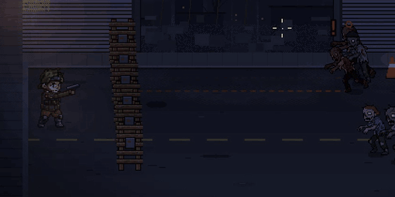
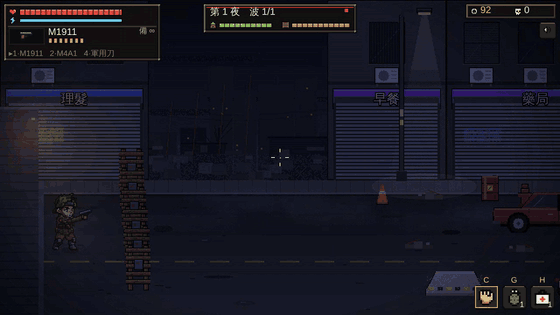

# 霧屍職業與隨機變異

一隻霧屍 = **職業**（制服外觀＋基礎能力）＋ **隨機外觀**（膚色、衣服顏色、頭飾、背包、血跡、體型）＋ **0～2 個變異**。
數值都在 `src/data/zombies.ts`，調平衡只改那個檔案。主選單按 **B** 開「霧屍圖鑑」，可以重擲外觀、點頭／身體測試護甲。

## 職業

| 職業 | 解鎖 | 特性 |
| --- | --- | --- |
| 平民 | 第 1 天 | 基準。隨機衣褲顏色、帽子、背包 |
| 慢跑者 | 第 1 天 | 快、脆 |
| 狂奔屍 | 第 1 天 | 靠近時**尖嘯＋蹲低蓄力**（0.85 秒，頭上紅色「！」、地上紅色衝刺路線），再直線衝刺撞上來（傷害 ×1.8）；蓄力中被爆頭／重擊會**打斷**，撞完會喘氣 0.9 秒 |
| 腫脹 | 第 1 天 | 血厚、抗擊退；**死亡爆開**波及主角、夥伴、路障與其他霧屍（可連鎖） |
| 工地 | 第 2 天 | 工程帽擋爆頭；**拆路障 ×2.5** |
| 警察 | 第 2 天 | **防彈背心**（身體減傷 45%，有耐久）；部分戴鎮暴頭盔 |
| 護理師 | 第 3 天 | 每 3 秒替附近霧屍回血，優先擊殺 |
| 消防員 | 第 3 天 | 防火衣天生減傷 25%、抗擊退／硬直、不怕火、拆路障 ×2 |
| 囚犯 | 第 4 天 | 血量過半**暴走**：速度 ×1.8、攻速加快 |
| 士兵 | 第 5 天 | 軍用頭盔＋防彈衣的重裝屍 |

## 體型與性別

每隻人形霧屍另外擲**體型**與**性別**（`BUILDS`、`FEMALE`，各職業可用 `builds`、`femaleChance` 調整比例）：

| 體型 | 外觀 | 數值 |
| --- | --- | --- |
| 瘦弱 | 窄 14% | 血 ×0.8、速度 ×1.12、傷害 ×0.9 |
| 普通 | — | — |
| 壯碩 | 寬 18% | 血 ×1.3、速度 ×0.88、傷害 ×1.15、擊退抵抗 +15% |
| 高大 | 大 10% | 血 ×1.15、傷害 ×1.1 |

女性霧屍：長髮／馬尾／鮑伯頭（7 種髮色）、部分穿裙子（膝下露腿）、身形略纖細；數值與男性相同，差異交給職業與體型。
體型只用橫向縮放（`spec.widthMul`），不另外合成貼圖；命中框跟著變寬變窄。

## 動物

| 動物 | 解鎖 | 行為 |
| --- | --- | --- |
| 屍犬 | 第 2 天 | 三隻一群；跑很快，靠近人會**撲咬**（傷害 ×1.5，冷卻 2.2 秒）；身形低，頭在判定框上方 40% |
| 屍鴉 | 第 3 天 | 三隻一群；**無視路障**，高空飛向最近的人再俯衝啄一下、拉高、重來；一槍就落，但要抬高槍口；不吃尖刺陷阱 |
| 屍熊 | 第 6 天 | 菁英；320 血、幾乎打不退；接近路障時**衝撞**，第一下傷害 ×2 |

圖是程式畫的（`src/art/AnimalArt.ts`：分三階陰影的橢圓＋粗線四肢＋自動描邊），每種 2–4 種毛色。
之後要換 PixelLab 圖，用相同 key（`animal_<種類>_<毛色>`）與影格順序載入即可。

## 出怪 API（探索模式、劇情事件共用）

```ts
import { spawnEnemy, enemyIds } from '../systems/ZombieFactory';
const z = spawnEnemy(scene, 'dog', x, y, { day: 4 });                       // 隨機外觀與變異
const boss = spawnEnemy(scene, 'bear', x, y, { day: 9, mutations: ['frenzied'] });
const girl = spawnEnemy(scene, 'nurse', x, y, { female: true, build: 'thin' });
enemyIds(5);            // 第 5 天可出現的全部 id
enemyIds(9, 'human');   // 只要人形
```

回傳的 `Zombie` 要放進場景的敵人清單，每幀 `update(dt, ctx)`（`ZombieContext` 見 `src/entities/Zombie.ts`）。

## 變異（依天數機率上升，第 6 天起可能疊兩個）

狂暴（快、攻速高）、巨型（大、血多、打得痛）、硬皮（天生減傷）、爆裂（死亡爆開）、再生（脫戰回血）。
有變異的霧屍頭上有一顆彩色菱形標記，顏色代表第一個變異。

## 護甲規則（給武器用）

`Zombie.takeDamage(amount, knockback, info)` 簽名不變，`HitInfo` 多了選填的 `type`、`penetration`：

- 爆頭打在**頭盔**、身體打在**防彈背心**：減傷 = `max(0, 護甲 − penetration)`，被吸收的傷害扣裝備耐久，歸零就壞（頭盔會飛走）。
- 天生減傷（消防衣、硬皮）不會壞，同樣扣掉穿甲。
- `type: 'blast'` 不分頭身、護甲效果減半；`type: 'blunt'` 對頭盔減傷減半、而且很快把頭盔敲飛。
- 擊退乘上 `(1 − knockbackResist)`；`zombie.stagger(秒)` 施加硬直，乘上 `(1 − staggerResist)`。

武器執行緒的 `src/combat/Damage.ts`（`resolveDamage`）合併後，把 `Zombie.mitigate()` 的公式換成呼叫它即可。

## 外觀怎麼做出來的（免費、不靠外部工具）

`src/art/ZombieComposer.ts` 在執行期以 `zombie_basic`（PixelLab 走路＋倒地 15 格）為底：

1. 依顏色把每個像素分成皮膚／上衣／褲子（和 `tools/art/make_zombie_variants.py` 同規則；白色眼睛另外排除）。
2. 保留原本的明暗，換成新的膚色與衣褲顏色，再畫上制服圖樣（警用背心、反光條、迷彩、手術服 V 領…）、背包與血跡。
3. 水平加寬做出體型差異，建立走路／攻擊／倒地動畫與爆頭用的頭部影格。
4. 頭飾是另一張小圖（`zgear`），依 `HEAD_ANCHORS`（每格頭頂位置）疊在頭上，所以能被打飛，也不會讓貼圖數量翻倍。

每個職業最多快取 8 組身體外觀（每組約 250KB），白天進場時就先把今晚會出現的職業合成好，避免夜裡卡頓。

## 波次

`buildNight(day)`（`src/data/waves.ts`）：第 1 夜沿用手調的 `NIGHT_ONE`，之後依「威脅點數預算」挑職業；
天數越大波數越多（最多 6 波）、預算越多，新解鎖的職業前兩天權重加倍，最後一波保證有一隻菁英。
屍犬、屍鴉以「群」為單位出現，一群一組、群與群間隔 6 秒。
第一次遇到某個職業時，畫面上方會跳出介紹。

### 壓迫感與節奏（屍潮）

- 所有職業基礎速度上調約 15–25%，另外每過一天再 +3%（`paceMul`，上限 +30%）。狂奔屍的衝刺速度固定，維持可反應。
- 每夜預算從 `10 + 5×天` 提高到 `13 + 6×天`。
- **屍潮**（`WaveDef.horde`，數值在 `HORDE`）：最後一波一定是屍潮，五波以上的夜晚中段再來一次。
  屍潮預算 ×1.6、出怪間隔 ×0.45，保證混進狂奔屍（1 + 天數/3 隻）。
  開始前 4 秒有預警（「遠方傳來嘶吼……」＋遠方嘶吼聲＋畫面邊緣泛紅），開始時大號「屍潮來襲！」橫幅和一片低吼。
  屍潮後那一波預算 ×0.75，給玩家喘口氣。
- 第一夜（`NIGHT_ONE`）：8 → 10+3 慢跑者+1 隻狂奔屍（第一次見面）→ 屍潮（16 平民＋4 慢跑者＋2 狂奔屍，密集出怪）。



